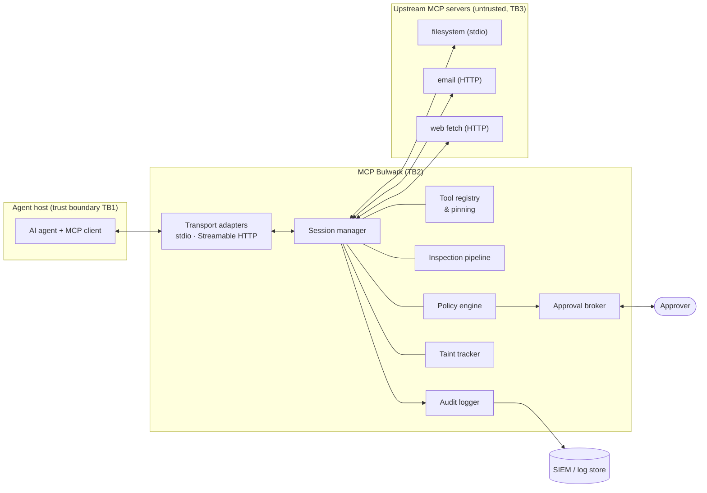
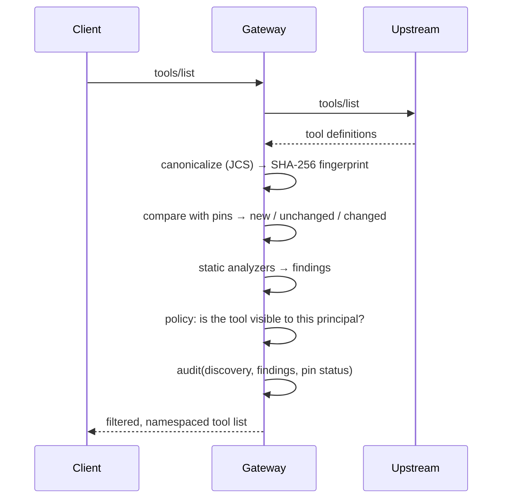
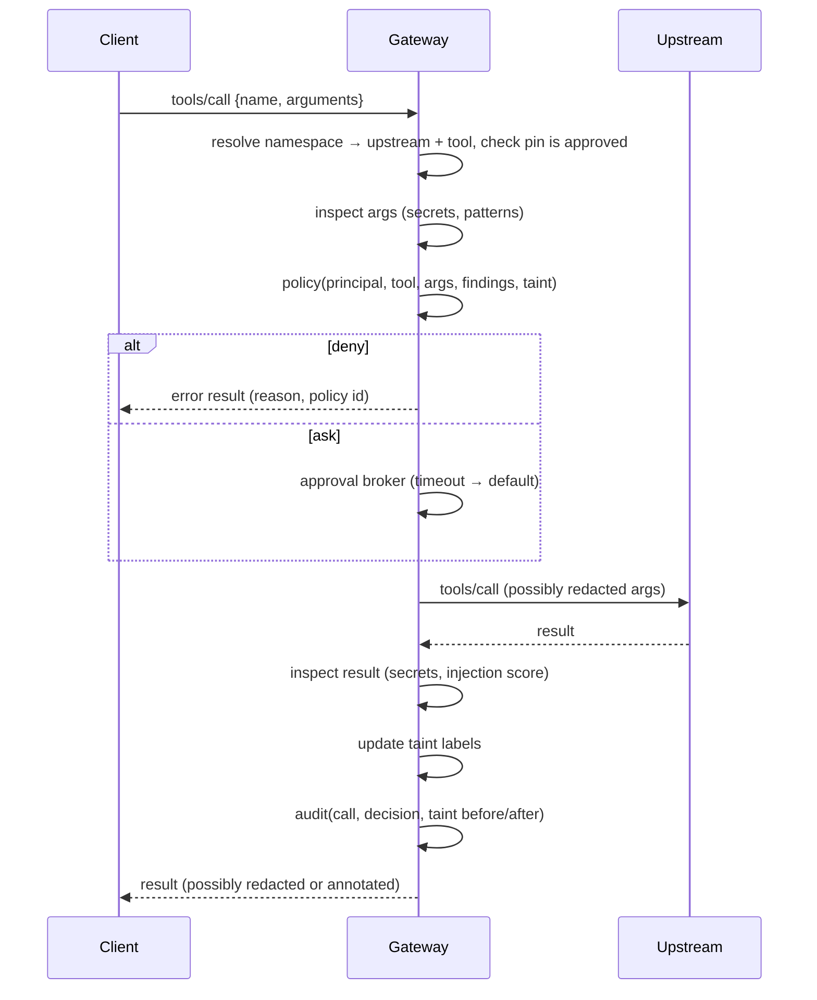

# MCP Bulwark: Design Document

## Document control
| Field | Value |
|---|---|
| Status | Draft (seeded; sections marked 🌱 have starting material, 📝 are not yet written) |
| Version | 0.3 |
| Last updated | 2026-11-26 |
| Idea brief | [IDEA.md](IDEA.md) |
| Reviewers | Staff security engineer, SRE, ML engineer (roles) |

### Change history
| Version | Date | Summary |
|---|---|---|
| 0.1 | 2026-11-25 | Initial skeleton with seeded architecture, flows, and threat model starters |
| 0.2 | 2026-11-26 | Lab-first roadmap: attack lab and baseline benchmark moved to M1; added FR-017/FR-018; spec backlog renumbered |
| 0.3 | 2026-11-26 | Moved to standalone repository; renamed to MCP Bulwark (CLI `bulwark`); decision 1 recorded as ADR-0001 |

> **How to use this document:** follow [docs/WORKFLOW.md](docs/WORKFLOW.md) Stage 1. Each section lists **Questions to resolve**. Work through them with Claude one section at a time, replace the seeded material with agreed content, and log decisions in §14.

---

## 1. Context and scope 🌱

### 1.1 Background
The Model Context Protocol (MCP) is a JSON-RPC 2.0 protocol. Through it, an **MCP client** (inside an agent host such as an IDE, desktop assistant, or custom agent) discovers and invokes **tools**, **resources**, and **prompts** exposed by **MCP servers**. Transports are **stdio** (the server runs as a local subprocess) and **Streamable HTTP** (a remote server). Everything a server says about its tools reaches the model's context, which makes the client–server boundary a security boundary that is rarely enforced.

MCP Bulwark is an **MCP-aware intermediary**. To the client it acts as a server, and to each upstream server it acts as a client. That position lets it inspect and control every message.

### 1.2 Scope
- **In scope:** tools (`tools/list`, `tools/call`, `notifications/tools/list_changed`). Resources and prompts get at least pinning and audit.
- **Decide:** server-to-client features (sampling, elicitation, roots). Pass through with audit, or enforce?
- **Out of scope:** see IDEA.md non-goals.

### 1.3 Target protocol revision
`VERIFY:` the latest MCP specification revision at design time. Revision `2025-11-25` is the most recent known to the drafter. Pin one revision, and document how version negotiation (`initialize` → `protocolVersion`) is handled when client and server versions differ.

### 1.4 Glossary
| Term | Definition |
|---|---|
| Tool definition | The `name`, `title`, `description`, `inputSchema`, `outputSchema`, and `annotations` of a tool, as returned by `tools/list` |
| Fingerprint | SHA-256 over the canonicalized (RFC 8785 JCS) tool definition |
| Pinning | Recording an approved fingerprint and refusing or alerting on any difference |
| Rug pull | A tool definition that changes after approval |
| Tool poisoning | Instructions aimed at the model hidden in tool metadata |
| Tool shadowing | A tool whose description manipulates how the agent uses *another* server's tools |
| Taint label | A session-level marker such as `untrusted_content` or `sensitive_data`, set when certain tool results enter the context |
| Principal | The identity on whose behalf a call is made (user, agent, or both) |

**Questions to resolve**
1. Should the MVP cover tools only, or also resources and prompts?
2. Which MCP spec revision is the baseline, and what is the policy on older clients and servers?
3. How should sampling and elicitation (server → client) be handled in v0.1?

---

## 2. Requirements 🌱

### 2.1 Functional requirements (draft; refine with Claude)
| ID | Requirement | Priority | Source |
|---|---|---|---|
| FR-001 | The gateway shall proxy MCP over stdio by launching and wrapping an upstream server command. | MVP | G1 |
| FR-002 | The gateway shall proxy MCP over Streamable HTTP to remote upstream servers. | MVP | G1 |
| FR-003 | The gateway shall aggregate multiple upstream servers behind one client connection, namespacing tool names to prevent collisions. | MVP | G1, G2 |
| FR-004 | The gateway shall compute a fingerprint for every tool definition and compare it to the pinned value. | MVP | G2 |
| FR-005 | When a tool is new or its fingerprint changed, the gateway shall act according to pinning mode (`learn` / `warn` / `enforce`). In `enforce`, the tool is hidden from the client until approved. | MVP | G2 |
| FR-006 | The gateway shall run static analyzers on tool definitions and attach findings with severities. | MVP | G2 |
| FR-007 | The gateway shall evaluate a policy for every `tools/call` and enforce `allow`, `deny`, or `ask`. | MVP | G3 |
| FR-008 | Policies shall be able to constrain arguments (for example path prefixes, domain allowlists, value patterns). | MVP | G3 |
| FR-009 | The gateway shall detect and redact secrets in tool arguments and results according to configuration. | MVP | G3, G4 |
| FR-010 | The gateway shall write an audit record for every message it decides on, with a hash chain over the records. | MVP | G5 |
| FR-011 | A CLI shall list tools, show diffs between pinned and current definitions, approve or reject them, and verify the audit chain. | MVP | G2, G5 |
| FR-012 | The gateway shall maintain session taint labels based on tool classifications and result inspection. | Later | G4 |
| FR-013 | Policies shall be able to reference session taint state. | Later | G4 |
| FR-014 | The gateway shall score tool results and definitions with a prompt-injection classifier. | Later | G2, G4 |
| FR-015 | An approval broker shall route `ask` decisions to a human channel and enforce timeouts. | Later | G3 |
| FR-016 | The gateway shall export audit events as OpenTelemetry and OCSF. | Later | G5 |
| FR-017 | The project shall include an attack lab of deliberately malicious but harmless MCP servers implementing scenarios L-01…L-06 (§10.3), using only canary secrets and a local exfiltration sink. | MVP | G7 |
| FR-018 | A benchmark harness shall run each lab scenario against configurable agents (client + model) in `direct`, `gateway-warn`, and `gateway-enforce` modes, and report attack success rate (ASR) and benign task success rate. | MVP | G7 |

### 2.2 Non-functional requirements (draft)
| ID | Category | Requirement | Measure |
|---|---|---|---|
| NFR-001 | Performance | Added latency p95 < 5 ms per message on the fast path (no ML, no human approval) | Load test, §10.2 |
| NFR-002 | Reliability | Configurable fail-closed (default) or fail-open when the policy engine is unavailable | Fault-injection test |
| NFR-003 | Security | The gateway holds upstream credentials. Clients never receive upstream tokens (no token passthrough). | Code review + integration test |
| NFR-004 | Integrity | Audit log tampering is detectable by `verify` | Tamper test |
| NFR-005 | Usability | Quickstart takes under 10 minutes | Timed run-through |
| NFR-006 | Portability | Runs on Linux, macOS, and Windows; ships as a single binary and a container image | CI matrix |
| NFR-007 | Privacy | No data leaves the host by default (local classifier; no telemetry) | Config review + network test |
| NFR-008 | Compatibility | Works unmodified with at least 3 popular MCP clients | Compatibility matrix |

**Questions to resolve**
1. Are the latency targets right? What is the latency budget for the ML classifier tier?
2. Should the default be fail-closed or fail-open? Should this differ between local developer mode and central deployment?
3. Which MCP clients make up the compatibility matrix?

---

## 3. Users and use cases 📝

Seed use cases to expand into full flows:
- **UC-01** A developer wraps a third-party stdio server locally, and the gateway catches a poisoned tool description.
- **UC-02** A server silently changes a tool description (rug pull). The tool is quarantined and a diff is shown.
- **UC-03** An agent reads a web page containing an injection, then tries to email internal data. The egress call is blocked because the session is tainted.
- **UC-04** A platform team deploys the gateway centrally with per-team policies.
- **UC-05** An IR analyst reconstructs an agent session from audit logs during an investigation.
- **UC-06** An auditor exports evidence that tool access is governed (feeds AI Compliance-as-Code).

**Questions to resolve**
1. Which two use cases are the "hero demos" for the README and launch?
2. For central deployment, what is the tenancy model (per team, per agent, per user)?

---

## 4. Architecture 🌱

### 4.1 System context



### 4.2 Component overview
| Component | Responsibility |
|---|---|
| Transport adapters | Terminate the client connection and connect to upstreams. Framing for stdio (newline-delimited JSON-RPC) and Streamable HTTP (POST + optional SSE stream, session header). |
| Session manager | Tracks each client session: principal, upstream connections, request ID mapping, taint state. Routes messages through the pipeline. |
| Tool registry & pinning | Canonicalizes and fingerprints definitions, stores approved pins, computes diffs, filters and namespaces the tool list shown to the client. |
| Inspection pipeline | Ordered analyzers (static rules, secret detection, ML classifier) that produce `Finding`s with scores. |
| Policy engine | Evaluates the decision input (principal, tool, args, findings, taint) to produce `allow` / `deny` / `ask` / `redact`, along with the matching policy IDs. |
| Taint tracker | Applies labels from tool classifications and findings. Exposes session state to policy. |
| Approval broker | Delivers `ask` decisions to a human (CLI prompt, webhook, or MCP elicitation). Enforces timeouts and the default decision. |
| Audit logger | Writes structured, hash-chained records. Optional exporters for OTel and OCSF. |
| CLI / admin API | Inventory, diff/approve, policy test, audit verify, config validation. |

### 4.3 Key flows

**Tool discovery (`tools/list`)**



**Tool invocation (`tools/call`)**



**Questions to resolve**
1. Aggregating proxy (one gateway, many servers) or one gateway process per server? (Recommendation: aggregating, which gives one place for policy and shared taint state across servers.)
2. On a deny, should the gateway return a JSON-RPC error or a tool result with `isError: true`? (Affects how agents recover. Test with real clients.)
3. Where is state stored (pins, approvals): local file, SQLite, or Postgres in central mode?

---

## 5. Detailed design 📝 (seed notes)

### 5.1 Tool registry and pinning
- Canonicalization: RFC 8785 JCS over `{server_id, name, title, description, inputSchema, outputSchema, annotations}`. Decide whether `annotations` count toward the fingerprint (recommendation: yes; any change is security-relevant).
- Pin store records: `server_id, tool_name, fingerprint, definition_snapshot, approved_by (role), approved_at, findings_at_approval`.
- Diffs are shown as a unified text diff of descriptions plus a structural JSON diff of schemas.
- `notifications/tools/list_changed` triggers re-discovery and re-evaluation of pins.
- **Server identity:** how is "the same server" established across runs? For stdio, a command + args + package version/hash. For HTTP, URL + TLS identity. `VERIFY:` whether the current MCP spec offers server identity metadata.

### 5.2 Static analyzers (definition inspection)
| Analyzer | Detects | Notes |
|---|---|---|
| `unicode.hidden` | Zero-width characters, bidi controls, Unicode Tags block (U+E0000–U+E007F), homoglyphs in names | High precision |
| `text.imperative` | Instructions aimed at the model ("ignore previous", "do not tell the user", `<IMPORTANT>` blocks) | Heuristic; tune against a benign corpus |
| `text.cross_reference` | Mentions of other tools or servers (shadowing) | Compare against the registry |
| `text.sensitive_ref` | References to `~/.ssh`, `.env`, credentials, tokens | |
| `schema.side_channel` | Free-text params that solicit context (`notes`, `context`, `metadata`) unrelated to the stated purpose | Exfiltration through arguments |
| `annotation.mismatch` | `readOnlyHint: true` on a tool whose name or description implies writes or egress | Annotations are **untrusted hints** per the MCP spec |
| `size.anomaly` | Unusually long descriptions | |

### 5.3 Policy engine
Decision input (draft):

```json
{
  "principal": {"id": "agent:code-assistant", "user": "user:alice@example.com", "groups": ["eng"]},
  "server": {"id": "web", "trust": "external"},
  "tool": {"name": "fetch", "capabilities": ["egress", "read_external"], "pin_status": "approved"},
  "arguments": {"url": "https://example.com/page"},
  "findings": [{"analyzer": "secrets", "severity": "high"}],
  "session": {"taint": ["sensitive_data"], "call_count": 14},
  "mode": "enforce"
}
```

Example Cedar policy (if Cedar is chosen; ADR pending):

```cedar
// Break the lethal trifecta: once a session holds sensitive data AND has
// seen untrusted content, egress-capable tools require human approval.
forbid (principal, action == Action::"call_tool", resource)
when {
  resource.capabilities.contains("egress") &&
  context.session.taint.contains("sensitive_data") &&
  context.session.taint.contains("untrusted_content")
}
unless { context.approval == "granted" };
```

### 5.4 Taint tracker (v0.2)
- Labels are **session-level and only ever added** (they are never removed within a session). This is coarse but sound and easy to reason about.
- Sources of labels: tool classification in config (for example `email.read` → `sensitive_data`, `web.fetch` → `untrusted_content`), server trust level, and analyzer findings on results.
- Capability tags on tools: `read`, `write`, `exec`, `egress`, `read_external`.
- Inspired by information-flow defenses such as CaMeL (Google DeepMind, 2025). Clearly document what this simplified model does *not* catch, such as egress through a write tool that syncs to the cloud.

### 5.5 Inspection of results
Secret detection (regex + entropy, using rule sets similar in spirit to gitleaks) and the injection classifier score (§8). Possible actions: annotate, redact, block, or add a taint label.

### 5.6 Approval broker (v0.2)
Channels: interactive CLI, webhook (Slack/Teams), and possibly MCP elicitation back to the client. `VERIFY:` whether elicitation is suitable, since it shows the request through the very client that might be compromised. Timeout leads to the policy-defined default (deny).

### 5.7 Audit logger
See §6.3 for the record schema. Hash chain: `hash = SHA-256(prev_hash || canonical(record))`. Periodic checkpoints can be signed or anchored externally (v0.2).

**Questions to resolve**
1. Do annotations count toward fingerprints?
2. How is server identity defined for stdio and HTTP?
3. Tag tools with capabilities manually, by heuristics, or both (heuristics suggest, humans confirm)?
4. Should argument redaction ever be silent, or should the agent always be told that redaction happened?

---

## 6. Interfaces and data model 🌱

### 6.1 CLI (draft)
```
bulwark run --config gateway.yaml           # start the gateway
bulwark wrap -- npx -y <server-package>    # quick local stdio wrapper
bulwark tools list|diff|approve|reject
bulwark policy test --input call.json      # dry-run a decision
bulwark audit verify|tail|export --format ocsf
bulwark lab run <scenario>                 # run attack lab scenarios
```

### 6.2 Configuration schema (draft)
```yaml
servers:
  filesystem:
    transport: stdio
    command: ["npx", "-y", "@modelcontextprotocol/server-filesystem", "/workspace"]
    trust: internal
    tools:
      read_file:  { capabilities: [read],  labels_on_result: [sensitive_data] }
      write_file: { capabilities: [write] }
  web:
    transport: http
    url: https://mcp.example.com/mcp
    trust: external
    auth: { type: oauth2, client_id_env: WEB_MCP_CLIENT_ID }
    default_labels_on_result: [untrusted_content]
pinning:
  mode: enforce            # learn | warn | enforce
  store: ./state/pins.db
policy:
  engine: cedar            # ADR pending: cedar | opa
  path: ./policies/
  on_engine_error: deny    # fail-closed
inspection:
  secrets: { enabled: true, action: redact }
  injection_classifier: { enabled: false }
audit:
  sink: file
  path: ./logs/audit.jsonl
  hash_chain: true
```

### 6.3 Audit record (draft)
```json
{
  "ts": "2026-11-25T14:03:22.118Z",
  "seq": 1042,
  "session_id": "s_7f3a",
  "principal": "agent:code-assistant",
  "event": "tool_call",
  "server": "web",
  "tool": "fetch",
  "args_digest": "sha256:…",
  "args_redacted": {"url": "https://example.com/page"},
  "decision": "deny",
  "policy_ids": ["trifecta-egress"],
  "findings": [],
  "taint_before": ["sensitive_data", "untrusted_content"],
  "taint_after":  ["sensitive_data", "untrusted_content"],
  "latency_ms": {"gateway": 1.8, "upstream": null},
  "prev_hash": "sha256:…",
  "hash": "sha256:…"
}
```
`VERIFY:` mapping to OCSF. API Activity (class 6003) is the likely fit; confirm the class and required fields against the current OCSF schema.

**Questions to resolve**
1. Should the config format be YAML with a JSON Schema for validation? (Recommended.)
2. Which arguments are logged in full, digested, or redacted by default?

---

## 7. Security and threat model 🌱

### 7.1 Assets
Upstream credentials · policy and pin store · audit log integrity · user data passing through · the availability of agents' tool access.

### 7.2 Trust boundaries
TB1 agent host ↔ gateway · TB2 gateway internals and state · TB3 gateway ↔ upstream servers (untrusted) · TB4 gateway ↔ approver channel · TB5 gateway ↔ log sink.

### 7.3 Threats addressed *by* the gateway (mapping to standards)
| Threat | OWASP Agentic Top 10 (Dec 2025) | OWASP LLM Top 10 (2026) | Control |
|---|---|---|---|
| Tool poisoning in descriptions | `VERIFY:` ASI02 Tool Misuse / ASI04 Agentic Supply Chain | LLM01 Prompt Injection | Static analyzers, pinning |
| Rug pull | `VERIFY:` ASI04 | — | Pinning in `enforce` mode |
| Tool shadowing / name collision | `VERIFY:` ASI02 | LLM01 | Namespacing, cross-reference analyzer |
| Indirect injection through tool results | `VERIFY:` ASI01 Agent Goal Hijack | LLM01 | Classifier, taint labels |
| Data exfiltration through egress tools or arguments | `VERIFY:` ASI02 | LLM02 Sensitive Information Disclosure | Taint policies, DLP, argument constraints |
| Excessive agency / over-privileged tools | `VERIFY:` ASI03 Identity & Privilege Abuse | `VERIFY:` Excessive Agency ID in 2026 list | Least-privilege policies |
| Token passthrough / confused deputy | `VERIFY:` ASI03 | — | Gateway-held credentials (NFR-003) |
| Exploiting human approval | `VERIFY:` ASI09 Human-Agent Trust Exploitation | — | Clear diffs, rate limits, approve by policy |

> `VERIFY:` all Agentic Top 10 IDs and titles against genai.owasp.org before approval. Also map to **MITRE ATLAS** techniques.

### 7.4 Threats *to* the gateway (STRIDE starter)
| ID | Boundary | STRIDE | Threat | Mitigation (draft) |
|---|---|---|---|---|
| T-01 | TB1 | Spoofing | A rogue local process connects as an agent | Local socket permissions; per-client tokens in central mode |
| T-02 | TB1 | Elevation | The agent bypasses the gateway and talks to servers directly | Only the gateway holds credentials; network egress policy; documented deployment requirement |
| T-03 | TB3 | Tampering | A malicious upstream sends malformed or huge JSON-RPC to crash or exploit the parser | Strict schema validation, size limits, fuzzing |
| T-04 | TB2 | Tampering | Pin store or policy files modified | File permissions, signed policy bundles (later), config integrity check at startup |
| T-05 | TB5 | Repudiation / Tampering | Audit records altered or deleted | Hash chain, external anchoring, append-only sink |
| T-06 | TB3 | Info disclosure | Secrets in results reach the model or logs | Redaction before logging and forwarding |
| T-07 | TB2 | DoS | Classifier or approval latency stalls agents | Timeouts, tiered inspection, circuit breakers |
| T-08 | TB2 | Evasion | Attacker tunes payloads to slip past the analyzers | Layered detectors, taint containment that doesn't depend on detection, adversarial test corpus |
| T-09 | TB4 | Spoofing | Fake approval responses | Authenticated approval channel, signed callbacks |

**Questions to resolve**
1. What is the default deployment posture (local developer vs. central), and which threats are accepted in each?
2. Is signed policy distribution needed for the MVP?

---

## 8. AI/ML design 📝 (seed notes)

- **Where AI is used:** only for *scoring* text (tool descriptions and results) for injection likelihood. All enforcement is deterministic policy, so the security boundary does not depend on a model behaving correctly.
- **Tiered inspection:** tier 0 regex/heuristics (always on, under 1 ms) → tier 1 a small local classifier (for example a fine-tuned DeBERTa-class prompt-injection model; `VERIFY:` current best open models and licenses) → tier 2 an optional LLM-as-judge for high-risk sessions (off by default, NFR-007).
- **Evaluation datasets:** the lab corpus (poisoned definitions, injected results), public prompt-injection datasets (`VERIFY:` licenses), and a benign corpus of real servers' tool definitions and typical results.
- **Metrics:** precision/recall/F1 per tier, FPR on benign traffic, latency per tier, end-to-end ASR (§10.3).
- **Failure modes:** false negatives (mitigated by taint containment), false positives (mitigated by `warn` mode and policy thresholds), model drift with new attack styles (refresh the corpus each release).
- **Fallback:** if the classifier is unavailable, tier 0 plus policy continue. Behavior is set by `on_classifier_error`.

**Questions to resolve**
1. Train or fine-tune your own classifier (strong portfolio signal; ML cost) or integrate an existing one (faster)?
2. Is tier 2 (LLM-as-judge) worth including at all, given privacy and latency?

---

## 9. Observability and operations 📝
Seed: structured logs, Prometheus metrics (decisions by type, latency histograms, findings by analyzer), OTel traces spanning client request → upstream call, health endpoints, hot reload of policies.

## 10. Testing and evaluation strategy 🌱

### 10.1 Test pyramid
Unit (analyzers, canonicalization, policy adapters) · property-based and fuzz tests (JSON-RPC parser, framing) · integration (real reference MCP servers) · end-to-end (real MCP clients with scripted agents).

### 10.2 NFR verification
Load test with a synthetic client/server pair to measure gateway-only latency (NFR-001). Fault injection for fail-closed behavior (NFR-002). Tamper tests (NFR-004).

### 10.3 Attack lab and benchmark
The lab is built **first** (M1, see §12). It establishes the baseline problem before any defenses exist, and every later milestone is measured against it.

`lab/` contains deliberately malicious, **harmless** MCP servers. "Exfiltration" goes to a local sink and "secrets" are fake canaries.

| Scenario | Description | Expected control |
|---|---|---|
| L-01 Poisoned description | Hidden `<IMPORTANT>` instruction to read `~/.ssh/id_rsa` (canary file) | Analyzer finding; tool quarantined |
| L-02 Rug pull | Definition changes after N calls | Pin mismatch → quarantine |
| L-03 Shadowing | Server B's description redirects use of server A's `send_email` | Cross-reference finding; namespacing |
| L-04 Indirect injection | Web page content instructs the agent to exfiltrate | Taint → egress blocked |
| L-05 Argument side channel | Schema solicits "context" containing secrets | Schema analyzer; DLP on arguments |
| L-06 Unicode smuggling | Tag-block characters encode instructions | `unicode.hidden` |

**Benchmark:** run each scenario N times with a real agent (several models and clients) under three conditions: no gateway, gateway in `warn` mode, gateway in `enforce` mode. Report attack success rate (ASR) and task success rate on benign tasks, so security and utility are measured together. Check existing benchmarks (`VERIFY:` for example "Damn Vulnerable MCP Server" and any MCP tool-poisoning benchmarks from the 2025–26 literature) and reuse them where licenses allow.

---

## 11. Deployment and packaging 📝
Seed: local mode (single binary wrapping stdio servers, configured in the agent's MCP config), central mode (container behind TLS, Postgres state, OIDC for admin), Helm chart later. Release signing with Sigstore/cosign, SBOM per release, SLSA provenance via GitHub Actions.

## 12. Milestones and roadmap 🌱
| Milestone | Scope | Exit criteria |
|---|---|---|
| M0 | Design approved | Design review checklist passed |
| M1 | **Attack lab + benchmark harness; baseline with no gateway** | L-01…L-06 reproducible; baseline ASR measured for ≥2 agents (client + model); **public write-up #1:** how easily agents are hijacked through their tools |
| M2 | Transparent proxy: stdio + HTTP passthrough with audit log | Works with 3 clients; benchmark runs through the gateway with unchanged benign task success; audit chain verifies |
| M3 | Registry + pinning + static analyzers + CLI | Lab L-01, L-02, L-03, L-06 detected |
| M4 | Policy engine + argument constraints + secret redaction; **v0.1 release** | Policy test suite; NFR-001 met; **public write-up #2:** before/after ASR |
| M5 | Taint tracking + approval broker | L-04, L-05 contained |
| M6 | Classifier tier + OTel/OCSF; **v0.2 release** | Classifier eval report |

**Why lab-first:** the maintainer's strength is offensive security. Building the attacks first (1) produces a publishable result early, (2) gives every later milestone an objective before/after measurement, and (3) keeps the defenses focused on attacks that are shown to work rather than hypothetical ones.

## 13. Alternatives considered 📝
To be written with ADRs. Expected entries: implementation language (Go / Rust / Python / TypeScript), policy engine (Cedar / OPA / custom DSL), deployment shape (sidecar per server vs. aggregator), and inline vs. out-of-band inspection.

## 14. Decision log and open questions

### 14.1 Decision log
| # | Decision | Rationale | ADR | Date |
|---|---|---|---|---|
| 1 | Lab-first roadmap: attack lab and baseline benchmark are M1, before any gateway code | Plays to offensive strengths, publishes a result early, and gives every milestone an objective before/after measure | [ADR-0001](docs/adr/0001-lab-first-roadmap.md) | 2026-11-26 |

### 14.2 Open questions (carried from IDEA.md)
- Q0 Lab implementation language. Can it differ from the gateway's? (The lab servers are small; using the official MCP SDK in TypeScript or Python is fine either way.)
- Q1 Core language: Go (official Go MCP SDK; `VERIFY:` maturity) vs. Python (official Python SDK; ML ecosystem) vs. hybrid
- Q2 Cedar vs. OPA/Rego
- Q3 Principal identity on stdio
- Q4 Scope of sampling/elicitation handling
- Q5 Classifier strategy

## 15. Spec backlog (draft)
| Spec | Title | Traces to | Milestone |
|---|---|---|---|
| 001 | Attack lab scenarios L-01…L-06 (canary secrets, local sink) | FR-017 | M1 |
| 002 | Benchmark harness + baseline report | FR-018 | M1 |
| 003 | stdio proxy passthrough | FR-001 | M2 |
| 004 | Streamable HTTP proxy passthrough | FR-002, NFR-003 | M2 |
| 005 | Hash-chained audit log + `audit verify` | FR-010, NFR-004 | M2 |
| 006 | Multi-server aggregation + namespacing | FR-003 | M3 |
| 007 | Fingerprinting + pin store + modes | FR-004, FR-005 | M3 |
| 008 | Static analyzers framework + first 6 analyzers | FR-006 | M3 |
| 009 | `tools` CLI (list/diff/approve) | FR-011 | M3 |
| 010 | Policy engine integration + decision input | FR-007, FR-008 | M4 |
| 011 | Secret detection + redaction | FR-009 | M4 |
| 012 | Taint tracker + taint-aware policy | FR-012, FR-013 | M5 |
| 013 | Approval broker | FR-015 | M5 |
| 014 | Injection classifier tier | FR-014 | M6 |
| 015 | OTel + OCSF exporters | FR-016 | M6 |

## Appendix: References
- Model Context Protocol specification: modelcontextprotocol.io (`VERIFY:` pinned revision)
- OWASP GenAI Security Project: Top 10 for LLM Applications 2026; Top 10 for Agentic Applications (Dec 2025): genai.owasp.org
- Cloud Security Alliance, *MCP Tool Poisoning and Rug Pull Attacks* whitepaper (May 2026)
- arXiv 2603.22489: study of tool-poisoning defenses in MCP clients (2026)
- Debenedetti et al., *Defeating Prompt Injections by Design* (CaMeL), Google DeepMind, 2025 (`VERIFY:` citation)
- Simon Willison, "The lethal trifecta for AI agents" (2025)
- RFC 8785 JSON Canonicalization Scheme; JSON-RPC 2.0 specification
- MITRE ATLAS: atlas.mitre.org
