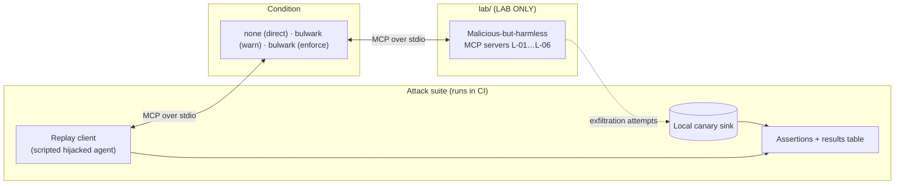
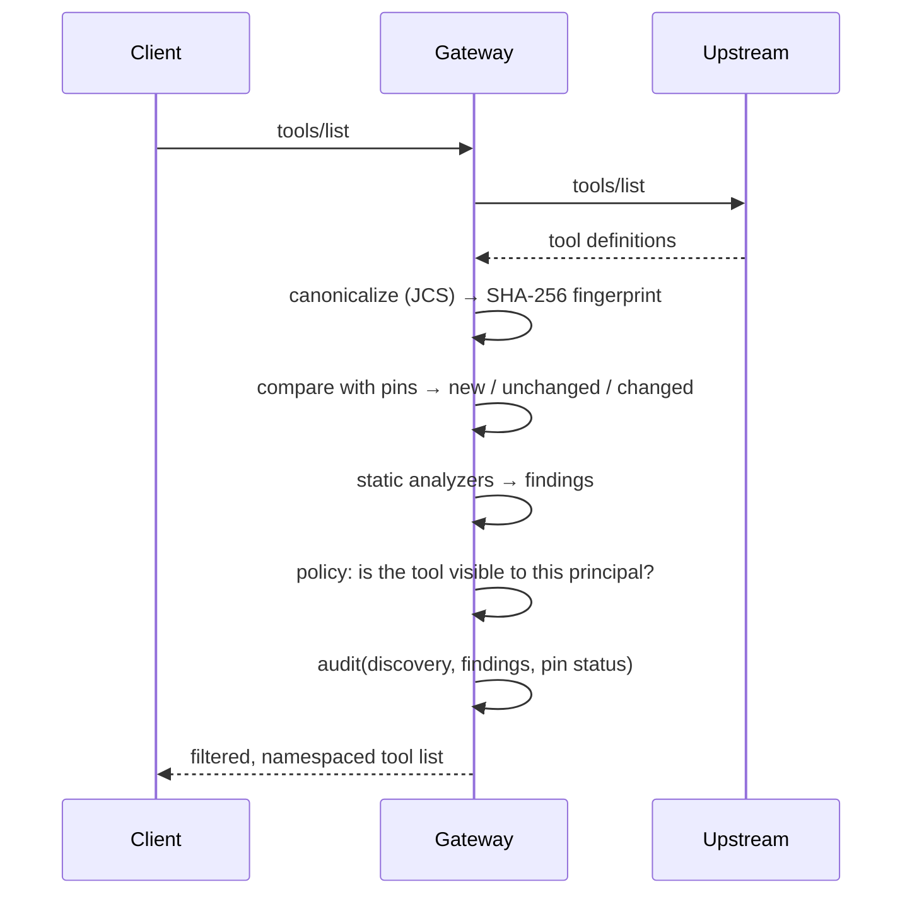
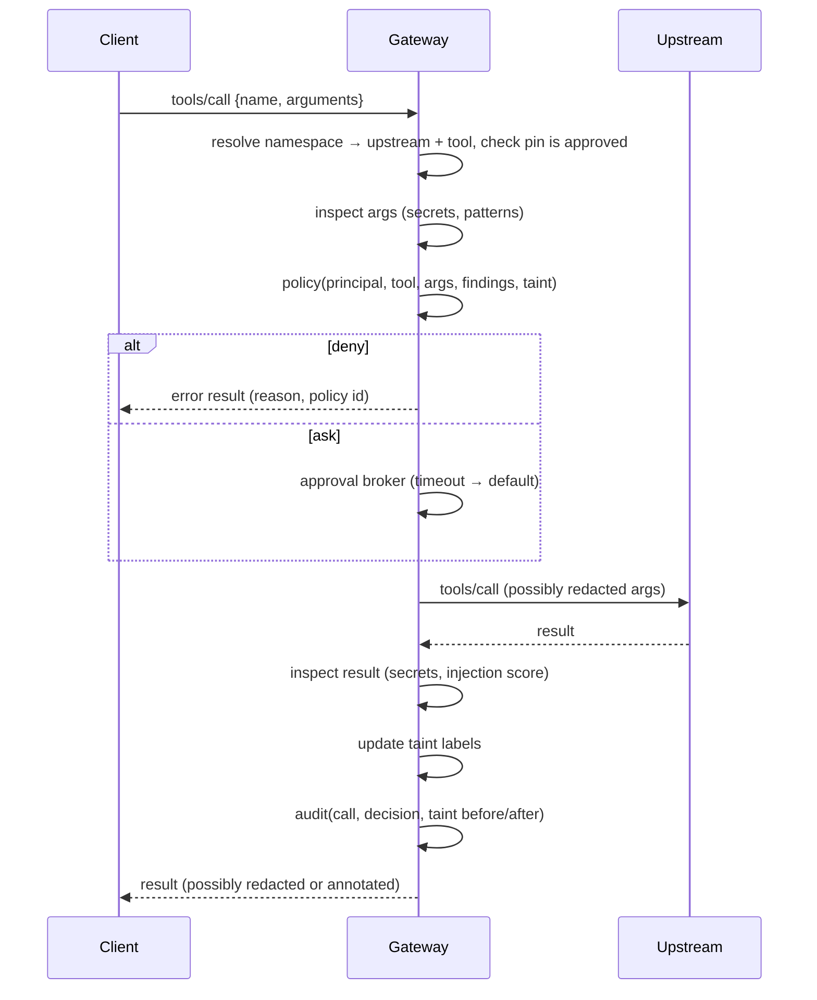

# MCP Bulwark: Design Document

## Document control
| Field | Value |
|---|---|
| Status | Draft: §1–§3 drafted and in review (✅); other sections seeded (🌱) or not yet written (📝) |
| Version | 0.5 |
| Last updated | 2026-11-26 |
| Idea brief | [IDEA.md](IDEA.md) |
| Reviewers | Staff security engineer, SRE, ML engineer (roles) |

### Change history
| Version | Date | Summary |
|---|---|---|
| 0.1 | 2026-11-25 | Initial skeleton with seeded architecture, flows, and threat model starters |
| 0.2 | 2026-11-26 | Lab-first roadmap: attack lab and baseline benchmark moved to M1; added FR-017/FR-018; spec backlog renumbered |
| 0.3 | 2026-11-26 | Moved to standalone repository; renamed to MCP Bulwark (CLI `bulwark`); decision 1 recorded as ADR-0001 |
| 0.4 | 2026-11-26 | (Superseded before merge) Evaluation-first draft with live-model benchmark |
| 0.5 | 2026-11-26 | Gateway with deterministic attack suite (ADR-0002, amends ADR-0001). Drafted §1–§3; renumbered FR/NFR; stdio-only v0.1; $0 and no-manual-testing constraints; updated §10, §12, §14, §15 |

> **How to use this document:** follow [docs/WORKFLOW.md](docs/WORKFLOW.md) Stage 1. Each section lists **Questions to resolve**. Work through them with Claude one section at a time, replace the seeded material with agreed content, and log decisions in §14.

---

## 1. Context and scope ✅ (drafted v0.5, in review)

### 1.1 Background
The **Model Context Protocol (MCP)** is a JSON-RPC 2.0 protocol. Through it, an **MCP client** (inside an agent host such as an IDE, desktop assistant, or custom agent) discovers and invokes **tools**, **resources**, and **prompts** exposed by **MCP servers**. Servers run locally over **stdio** (as a subprocess) or remotely over **Streamable HTTP**. Everything a server says about its tools reaches the model's context, which makes the client–server boundary a security boundary that is rarely enforced.

MCP Bulwark is an **MCP-aware intermediary**. It acts as a server to the client and as a client to the upstream server, so it can inspect and control every message. It ships with an **attack suite** that proves each protection ([ADR-0002](docs/adr/0002-gateway-with-attack-suite.md)):



**Why no AI model is needed:** Bulwark never relies on the model behaving well. It controls what reaches the model (tool definitions, results) and which calls get through. A scripted client that sends exactly what a hijacked agent would send tests those controls deterministically. How often real models get hijacked is covered by published research (for example MCPTox), which the docs cite.

### 1.2 Scope

| Area | In scope for v0.1 | Deferred |
|---|---|---|
| Transport | stdio | Streamable HTTP (v0.2) |
| Servers per gateway | One upstream server per gateway process | Multi-server aggregation with namespacing (v0.2) |
| MCP features enforced | `tools/list`, `tools/call`, `notifications/tools/list_changed` | Resources and prompts: pinning and audit only (v0.2) |
| Server-initiated requests (sampling, elicitation, roots) | **Passed through and audited, not enforced** | Policy enforcement (v0.2+) |
| Testing | Deterministic replay scenarios + detection corpora, all in CI | Optional "bring your own model" live mode (later) |
| Session-level defenses | Per-call policy only | Taint tracking (v0.2) |

### 1.3 Target protocol revision
`VERIFY:` the latest MCP specification revision at design time. Revision `2025-11-25` is the most recent known to the drafter. v0.1 pins one revision. If client and server propose different `protocolVersion` values in `initialize`, the gateway forwards the negotiation unchanged and records both values in the audit log.

### 1.4 Glossary
| Term | Definition |
|---|---|
| Tool definition | The `name`, `title`, `description`, `inputSchema`, `outputSchema`, and `annotations` of a tool, as returned by `tools/list` |
| Fingerprint | SHA-256 over the canonicalized (RFC 8785 JCS) tool definition |
| Pinning | Recording an approved fingerprint and alerting on or blocking any difference |
| Rug pull | A tool definition that changes after approval |
| Tool poisoning | Instructions aimed at the model hidden in tool metadata |
| Tool shadowing | A tool whose description manipulates how the agent uses *another* tool |
| Scenario | A lab server plus a replay script and expected outcomes per condition |
| Replay client | A scripted MCP client that sends the messages a hijacked agent would send. No AI model involved |
| Condition | How the replay client reaches the lab server: `none` (direct), `bulwark-warn`, or `bulwark-enforce` |
| Canary | A fake secret planted in the lab. If it reaches the sink, data was exfiltrated |
| Sink | A loopback-only listener that records canaries |
| Observables | What each scenario checks: `poison_delivered` (malicious text reached the client), `forbidden_call_executed` (the upstream server ran a call it shouldn't have), `canary_exfiltrated` (a canary reached the sink) |
| Detection corpus | A set of tool definitions (poisoned or benign) used to measure analyzer detection and false-positive rates |

---

## 2. Requirements ✅ (drafted v0.5, in review)

Requirement IDs: **FR-001…FR-019 attack suite and evaluation**, **FR-020…FR-039 Gateway v0.1**, **FR-040+ later**.

### 2.1 Functional requirements

**Attack suite and evaluation**
| ID | Requirement | Priority | Source |
|---|---|---|---|
| FR-001 | The suite shall provide scenarios L-01…L-06 (§10.3) as stdio MCP servers in `lab/`. Each has a manifest declaring ID, technique, OWASP/ATLAS mapping, replay script, and expected observables per condition. | MVP | G5 |
| FR-002 | Lab servers shall use canary secrets only, send data only to the loopback sink, and make no other network connections. | MVP | G5 |
| FR-003 | The replay client shall execute a scenario's replay script (`initialize`, `tools/list`, `tools/call` with given arguments, waits for notifications) and record every message sent and received. | MVP | G5 |
| FR-004 | For each scenario, the suite shall assert the expected observables under each condition. At minimum, the attack must **succeed under `none`**, proving the scenario is real, and be **blocked or detected under `bulwark-enforce`**. | MVP | G5 |
| FR-005 | CI shall run the suite on every PR and publish a results table (scenario × condition) in the job summary. A failing assertion fails the build. | MVP | G5 |
| FR-006 | An analyzer corpus test shall report detection rate on poisoned tool definitions (MCPTox subset, if its license permits; `VERIFY:` license and format) and false-positive rate on benign tool definitions from real open-source MCP servers. | MVP | G2, G5 |
| FR-007 | A one-command demo (`make demo` or a container image) shall run selected scenarios with and without Bulwark and print the results table, with no setup beyond Docker or the release binary. | MVP | G6 |

**Bulwark Gateway (v0.1, stdio)**
| ID | Requirement | Priority | Source |
|---|---|---|---|
| FR-020 | Gateway shall wrap one upstream stdio server command and proxy all MCP messages between client and server transparently when no policy applies. | MVP | G1 |
| FR-021 | Gateway shall fingerprint every tool definition and compare it to the pin store. New or changed tools are handled by mode: `learn` (pin automatically), `warn` (forward and alert), `enforce` (hide the tool from the client until approved). | MVP | G2 |
| FR-022 | Gateway shall run static analyzers on tool definitions and record findings with severities. At minimum: hidden Unicode, model-directed instructions, cross-tool references, and side-channel schema parameters. In `enforce` mode, tools with high-severity findings are hidden until approved. | MVP | G2 |
| FR-023 | Gateway shall evaluate a policy for every `tools/call` and enforce `allow` or `deny`. `ask` is resolved by an interactive terminal prompt when one is available; otherwise it is treated as `deny`. | MVP | G3 |
| FR-024 | Policies shall be able to constrain arguments: path prefixes, URL/domain allowlists, and regex patterns. | MVP | G3 |
| FR-025 | Gateway shall detect secrets in tool arguments and results (pattern and entropy based) and redact them according to configuration. | MVP | G3 |
| FR-026 | Gateway shall write an audit record for every decision, chained with SHA-256 hashes so that any modification or deletion is detectable. | MVP | G4 |
| FR-027 | The CLI shall support: `wrap`, `tools list/diff/approve/reject`, `policy test`, and `audit verify/tail`. | MVP | G1–G4 |

**Later (v0.2+)**
| ID | Requirement | Priority |
|---|---|---|
| FR-040 | Streamable HTTP transport | Later |
| FR-041 | Multi-server aggregation with tool namespacing | Later |
| FR-042 | Session taint tracking and taint-aware policy | Later |
| FR-043 | Out-of-band human approval broker | Later |
| FR-044 | Prompt-injection classifier tier (CPU-only, runs in CI) | Later |
| FR-045 | OpenTelemetry and OCSF audit export | Later |
| FR-046 | Optional live-model mode: run scenarios with a real agent against a user-supplied OpenAI-compatible endpoint | Later |

### 2.2 Non-functional requirements
| ID | Category | Requirement | Measure |
|---|---|---|---|
| NFR-001 | Cost | Development, CI, and demo use no paid service | Dependency and workflow review |
| NFR-002 | Automation | All verification runs in GitHub Actions. No requirement needs a manual or local test step by the maintainer. | Every NFR and FR maps to a CI job (§10) |
| NFR-003 | Lab safety | The suite passes in a container with all networking disabled except loopback. Any other connection attempt fails the run. | CI job |
| NFR-004 | Performance | Gateway adds p95 < 5 ms per message (no ML, no human approval) | Benchmark test in CI |
| NFR-005 | Reliability | Gateway fails closed by default if policy evaluation errors | Fault-injection test |
| NFR-006 | Integrity | `audit verify` detects any modified, inserted, or deleted audit record | Tamper tests |
| NFR-007 | Privacy | No data leaves the host: no telemetry, no external calls by the gateway | Network test in CI |
| NFR-008 | Determinism | Suite results are identical across reruns (no flaky tests) | Each CI run executes the suite twice and compares results |
| NFR-009 | CI time | The full CI pipeline finishes in ≤ 10 minutes | CI timing |
| NFR-010 | Portability | Linux and macOS supported; Windows best-effort | CI matrix |
| NFR-011 | Usability | A reviewer goes from clone (or release download) to demo output in ≤ 10 minutes | Documented quickstart, scripted in CI |
| NFR-012 | Supply chain | Releases are built in CI with an SBOM and signatures (Sigstore) | Release workflow |

### 2.3 Constraints and assumptions
| ID | Type | Statement |
|---|---|---|
| C-1 | Constraint | $0 budget (NFR-001). No paid APIs, hosted services, or paid GitHub features. |
| C-2 | Constraint | Maintainer time is 1–2 hours/week. Claude designs, builds, and tests; the maintainer reviews PRs (≤ 30 minutes each). |
| C-3 | Constraint | No manual testing or local model runs (NFR-002). |
| C-4 | Constraint | The repo is private until the v0.1 launch. GitHub Actions minutes for private repos on the Free plan are limited (`VERIFY:` current allowance; 2,000 minutes/month at time of drafting). At ≤ 10 minutes per run (NFR-009) this allows about 200 runs per month. |
| A-1 | Assumption | Protocol-level replay is a faithful test of Bulwark's controls, because Bulwark acts only on protocol messages. It does **not** show how often a model would follow the malicious instructions. The docs cite published research for that (R3 in IDEA.md). |
| A-2 | Assumption | Official MCP SDKs are mature enough to build both the gateway and the lab servers (`VERIFY:` SDK for the language chosen in design 02). |

---

## 3. Users and use cases ✅ (drafted v0.5, in review)

### 3.1 Personas
See [IDEA.md](IDEA.md#target-users). The primary persona for v0.1 is the **developer using agents**. The **portfolio reviewer** is a first-class persona: the README, demo, and design docs are written for a 10-minute evaluation.

### 3.2 Use cases
| ID | Actor | Trigger | Main flow | Outcome | Traces to |
|---|---|---|---|---|---|
| UC-01 | Portfolio reviewer | Opens the repo | Reads the README, runs `make demo` (or the container) | Sees each attack succeed without Bulwark and get blocked with it, in one table | FR-007, NFR-011 |
| UC-02 | Developer | Adds a third-party stdio server | Wraps it with `bulwark wrap -- <cmd>` in `learn` mode, reviews findings, switches to `enforce` | Poisoned description flagged; tool hidden until approved | FR-020…022, FR-027 |
| UC-03 | Developer | A server silently changes a tool (rug pull) | Gateway detects a fingerprint mismatch on the next `tools/list` | Tool quarantined; `bulwark tools diff` shows the change | FR-021, FR-027 |
| UC-04 | Developer | A hijacked agent tries to send data to an unapproved domain | Policy with a domain allowlist evaluates the `tools/call` | Call denied with the policy ID; audit record written | FR-023, FR-024, FR-026 |
| UC-05 | IR analyst | Investigating an agent's actions | `bulwark audit verify`, then `audit tail` filtered by session | Integrity confirmed; session reconstructed | FR-026, FR-027 |
| UC-06 | Contributor | Wants to add an attack | Proposes a scenario through the issue template; implements it under `lab/` with a manifest | CI runs it on every PR from then on | FR-001…005 |

### 3.3 Hero demos (README and launch write-up)
1. **UC-01 "Attacks vs. Bulwark"**: one table and a terminal recording of six attacks, each succeeding directly and blocked through Bulwark.
2. **UC-03 "Rug pull caught"**: a tool changes after approval, is quarantined, and the diff is shown.

---

## 4. Architecture 🌱

> **Pending revision (next design PR):** add the attack suite components (replay client, lab servers, sink, CI results) shown in §1.1, and reduce Gateway to one upstream server for v0.1 (§1.2). The diagrams below still show the full multi-server Gateway.

### 4.1 System context


### 4.2 Component overview
| Component | Responsibility |
|---|---|
| Transport adapters | Terminate the client connection and connect to upstreams. Framing for stdio (newline-delimited JSON-RPC) and Streamable HTTP (POST + optional SSE stream, session header). |
| Session manager | Tracks each client session: principal, upstream connections, request ID mapping, taint state. Routes messages through the pipeline. |
| Tool registry & pinning | Canonicalizes and fingerprints definitions, stores approved pins, computes diffs, filters and namespaces the tool list shown to the client. |
| Inspection pipeline | Ordered analyzers (static rules, secret detection, ML classifier) that produce `Finding`s with scores. |
| Policy engine | Evaluates the decision input (principal, tool, args, findings, taint) to produce `allow` / `deny` / `ask` / `redact`, along with the matching policy IDs. |
| Taint tracker | Applies labels from tool classifications and findings. Exposes session state to policy. |
| Approval broker | Delivers `ask` decisions to a human (CLI prompt, webhook, or MCP elicitation). Enforces timeouts and the default decision. |
| Audit logger | Writes structured, hash-chained records. Optional exporters for OTel and OCSF. |
| CLI / admin API | Inventory, diff/approve, policy test, audit verify, config validation. |

### 4.3 Key flows

**Tool discovery (`tools/list`)**



**Tool invocation (`tools/call`)**



**Questions to resolve**
1. Aggregating proxy (one gateway, many servers) or one gateway process per server? (Recommendation: aggregating, which gives one place for policy and shared taint state across servers.)
2. On a deny, should the gateway return a JSON-RPC error or a tool result with `isError: true`? (Affects how agents recover. Test with real clients.)
3. Where is state stored (pins, approvals): local file, SQLite, or Postgres in central mode?

---

## 5. Detailed design 📝 (seed notes)

### 5.1 Tool registry and pinning
- Canonicalization: RFC 8785 JCS over `{server_id, name, title, description, inputSchema, outputSchema, annotations}`. Decide whether `annotations` count toward the fingerprint (recommendation: yes; any change is security-relevant).
- Pin store records: `server_id, tool_name, fingerprint, definition_snapshot, approved_by (role), approved_at, findings_at_approval`.
- Diffs are shown as a unified text diff of descriptions plus a structural JSON diff of schemas.
- `notifications/tools/list_changed` triggers re-discovery and re-evaluation of pins.
- **Server identity:** how is "the same server" established across runs? For stdio, a command + args + package version/hash. For HTTP, URL + TLS identity. `VERIFY:` whether the current MCP spec offers server identity metadata.

### 5.2 Static analyzers (definition inspection)
| Analyzer | Detects | Notes |
|---|---|---|
| `unicode.hidden` | Zero-width characters, bidi controls, Unicode Tags block (U+E0000–U+E007F), homoglyphs in names | High precision |
| `text.imperative` | Instructions aimed at the model ("ignore previous", "do not tell the user", `<IMPORTANT>` blocks) | Heuristic; tune against a benign corpus |
| `text.cross_reference` | Mentions of other tools or servers (shadowing) | Compare against the registry |
| `text.sensitive_ref` | References to `~/.ssh`, `.env`, credentials, tokens | |
| `schema.side_channel` | Free-text params that solicit context (`notes`, `context`, `metadata`) unrelated to the stated purpose | Exfiltration through arguments |
| `annotation.mismatch` | `readOnlyHint: true` on a tool whose name or description implies writes or egress | Annotations are **untrusted hints** per the MCP spec |
| `size.anomaly` | Unusually long descriptions | |

### 5.3 Policy engine
Decision input (draft):

```json
{
  "principal": {"id": "agent:code-assistant", "user": "user:alice@example.com", "groups": ["eng"]},
  "server": {"id": "web", "trust": "external"},
  "tool": {"name": "fetch", "capabilities": ["egress", "read_external"], "pin_status": "approved"},
  "arguments": {"url": "https://example.com/page"},
  "findings": [{"analyzer": "secrets", "severity": "high"}],
  "session": {"taint": ["sensitive_data"], "call_count": 14},
  "mode": "enforce"
}
```

Example Cedar policy (if Cedar is chosen; ADR pending):

```cedar
// Break the lethal trifecta: once a session holds sensitive data AND has
// seen untrusted content, egress-capable tools require human approval.
forbid (principal, action == Action::"call_tool", resource)
when {
  resource.capabilities.contains("egress") &&
  context.session.taint.contains("sensitive_data") &&
  context.session.taint.contains("untrusted_content")
}
unless { context.approval == "granted" };
```

### 5.4 Taint tracker (v0.2)
- Labels are **session-level and only ever added** (they are never removed within a session). This is coarse but sound and easy to reason about.
- Sources of labels: tool classification in config (for example `email.read` → `sensitive_data`, `web.fetch` → `untrusted_content`), server trust level, and analyzer findings on results.
- Capability tags on tools: `read`, `write`, `exec`, `egress`, `read_external`.
- Inspired by information-flow defenses such as CaMeL (Google DeepMind, 2025). Clearly document what this simplified model does *not* catch, such as egress through a write tool that syncs to the cloud.

### 5.5 Inspection of results
Secret detection (regex + entropy, using rule sets similar in spirit to gitleaks) and the injection classifier score (§8). Possible actions: annotate, redact, block, or add a taint label.

### 5.6 Approval broker (v0.2)
Channels: interactive CLI, webhook (Slack/Teams), and possibly MCP elicitation back to the client. `VERIFY:` whether elicitation is suitable, since it shows the request through the very client that might be compromised. Timeout leads to the policy-defined default (deny).

### 5.7 Audit logger
See §6.3 for the record schema. Hash chain: `hash = SHA-256(prev_hash || canonical(record))`. Periodic checkpoints can be signed or anchored externally (v0.2).

**Questions to resolve**
1. Do annotations count toward fingerprints?
2. How is server identity defined for stdio and HTTP?
3. Tag tools with capabilities manually, by heuristics, or both (heuristics suggest, humans confirm)?
4. Should argument redaction ever be silent, or should the agent always be told that redaction happened?

---

## 6. Interfaces and data model 🌱

### 6.1 CLI (draft)
```
bulwark run --config gateway.yaml           # start the gateway
bulwark wrap -- npx -y <server-package>    # quick local stdio wrapper
bulwark tools list|diff|approve|reject
bulwark policy test --input call.json      # dry-run a decision
bulwark audit verify|tail|export --format ocsf
bulwark lab run <scenario>                 # run attack lab scenarios
```

### 6.2 Configuration schema (draft)
```yaml
servers:
  filesystem:
    transport: stdio
    command: ["npx", "-y", "@modelcontextprotocol/server-filesystem", "/workspace"]
    trust: internal
    tools:
      read_file:  { capabilities: [read],  labels_on_result: [sensitive_data] }
      write_file: { capabilities: [write] }
  web:
    transport: http
    url: https://mcp.example.com/mcp
    trust: external
    auth: { type: oauth2, client_id_env: WEB_MCP_CLIENT_ID }
    default_labels_on_result: [untrusted_content]
pinning:
  mode: enforce            # learn | warn | enforce
  store: ./state/pins.db
policy:
  engine: cedar            # ADR pending: cedar | opa
  path: ./policies/
  on_engine_error: deny    # fail-closed
inspection:
  secrets: { enabled: true, action: redact }
  injection_classifier: { enabled: false }
audit:
  sink: file
  path: ./logs/audit.jsonl
  hash_chain: true
```

### 6.3 Audit record (draft)
```json
{
  "ts": "2026-11-25T14:03:22.118Z",
  "seq": 1042,
  "session_id": "s_7f3a",
  "principal": "agent:code-assistant",
  "event": "tool_call",
  "server": "web",
  "tool": "fetch",
  "args_digest": "sha256:…",
  "args_redacted": {"url": "https://example.com/page"},
  "decision": "deny",
  "policy_ids": ["trifecta-egress"],
  "findings": [],
  "taint_before": ["sensitive_data", "untrusted_content"],
  "taint_after":  ["sensitive_data", "untrusted_content"],
  "latency_ms": {"gateway": 1.8, "upstream": null},
  "prev_hash": "sha256:…",
  "hash": "sha256:…"
}
```
`VERIFY:` mapping to OCSF. API Activity (class 6003) is the likely fit; confirm the class and required fields against the current OCSF schema.

**Questions to resolve**
1. Should the config format be YAML with a JSON Schema for validation? (Recommended.)
2. Which arguments are logged in full, digested, or redacted by default?

---

## 7. Security and threat model 🌱

### 7.1 Assets
Upstream credentials · policy and pin store · audit log integrity · user data passing through · the availability of agents' tool access.

### 7.2 Trust boundaries
TB1 agent host ↔ gateway · TB2 gateway internals and state · TB3 gateway ↔ upstream servers (untrusted) · TB4 gateway ↔ approver channel · TB5 gateway ↔ log sink.

### 7.3 Threats addressed *by* the gateway (mapping to standards)
| Threat | OWASP Agentic Top 10 (Dec 2025) | OWASP LLM Top 10 (2026) | Control |
|---|---|---|---|
| Tool poisoning in descriptions | `VERIFY:` ASI02 Tool Misuse / ASI04 Agentic Supply Chain | LLM01 Prompt Injection | Static analyzers, pinning |
| Rug pull | `VERIFY:` ASI04 | — | Pinning in `enforce` mode |
| Tool shadowing / name collision | `VERIFY:` ASI02 | LLM01 | Namespacing, cross-reference analyzer |
| Indirect injection through tool results | `VERIFY:` ASI01 Agent Goal Hijack | LLM01 | Classifier, taint labels |
| Data exfiltration through egress tools or arguments | `VERIFY:` ASI02 | LLM02 Sensitive Information Disclosure | Taint policies, DLP, argument constraints |
| Excessive agency / over-privileged tools | `VERIFY:` ASI03 Identity & Privilege Abuse | `VERIFY:` Excessive Agency ID in 2026 list | Least-privilege policies |
| Token passthrough / confused deputy | `VERIFY:` ASI03 | — | Gateway-held credentials (with Streamable HTTP, v0.2) |
| Exploiting human approval | `VERIFY:` ASI09 Human-Agent Trust Exploitation | — | Clear diffs, rate limits, approve by policy |

> `VERIFY:` all Agentic Top 10 IDs and titles against genai.owasp.org before approval. Also map to **MITRE ATLAS** techniques.

### 7.4 Threats *to* the gateway (STRIDE starter)
| ID | Boundary | STRIDE | Threat | Mitigation (draft) |
|---|---|---|---|---|
| T-01 | TB1 | Spoofing | A rogue local process connects as an agent | Local socket permissions; per-client tokens in central mode |
| T-02 | TB1 | Elevation | The agent bypasses the gateway and talks to servers directly | Only the gateway holds credentials; network egress policy; documented deployment requirement |
| T-03 | TB3 | Tampering | A malicious upstream sends malformed or huge JSON-RPC to crash or exploit the parser | Strict schema validation, size limits, fuzzing |
| T-04 | TB2 | Tampering | Pin store or policy files modified | File permissions, signed policy bundles (later), config integrity check at startup |
| T-05 | TB5 | Repudiation / Tampering | Audit records altered or deleted | Hash chain, external anchoring, append-only sink |
| T-06 | TB3 | Info disclosure | Secrets in results reach the model or logs | Redaction before logging and forwarding |
| T-07 | TB2 | DoS | Classifier or approval latency stalls agents | Timeouts, tiered inspection, circuit breakers |
| T-08 | TB2 | Evasion | Attacker tunes payloads to slip past the analyzers | Layered detectors, taint containment that doesn't depend on detection, adversarial test corpus |
| T-09 | TB4 | Spoofing | Fake approval responses | Authenticated approval channel, signed callbacks |

**Questions to resolve**
1. What is the default deployment posture (local developer vs. central), and which threats are accepted in each?
2. Is signed policy distribution needed for the MVP?

---

## 8. AI/ML design 📝 (seed notes)

- **Where AI is used:** only for *scoring* text (tool descriptions and results) for injection likelihood. All enforcement is deterministic policy, so the security boundary does not depend on a model behaving correctly.
- **Tiered inspection:** tier 0 regex/heuristics (always on, under 1 ms) → tier 1 a small local classifier (for example a fine-tuned DeBERTa-class prompt-injection model; `VERIFY:` current best open models and licenses) → tier 2 an optional LLM-as-judge for high-risk sessions (off by default, NFR-007).
- **Evaluation datasets:** the lab corpus (poisoned definitions, injected results), public prompt-injection datasets (`VERIFY:` licenses), and a benign corpus of real servers' tool definitions and typical results.
- **Metrics:** precision/recall/F1 per tier, FPR on benign traffic, latency per tier, and the attack suite (§10.3) with the classifier enabled.
- **Failure modes:** false negatives (mitigated by taint containment), false positives (mitigated by `warn` mode and policy thresholds), model drift with new attack styles (refresh the corpus each release).
- **Fallback:** if the classifier is unavailable, tier 0 plus policy continue. Behavior is set by `on_classifier_error`.

**Questions to resolve**
1. Train or fine-tune your own classifier (strong portfolio signal; ML cost) or integrate an existing one (faster)?
2. Is tier 2 (LLM-as-judge) worth including at all, given privacy and latency?

---

## 9. Observability and operations 📝
Seed: structured logs, Prometheus metrics (decisions by type, latency histograms, findings by analyzer), OTel traces spanning client request → upstream call, health endpoints, hot reload of policies.

## 10. Testing and evaluation strategy 🌱

### 10.1 Test pyramid
Unit (analyzers, canonicalization, policy adapters) · property-based and fuzz tests (JSON-RPC parser, framing) · integration (real reference MCP servers) · end-to-end (real MCP clients with scripted agents).

### 10.2 NFR verification
Every NFR is checked by a CI job (NFR-002): load/latency test (NFR-004), fault injection (NFR-005), audit tamper tests (NFR-006), network-isolated suite run (NFR-003, NFR-007), double-run determinism check (NFR-008), pipeline timing (NFR-009), OS matrix (NFR-010), scripted quickstart (NFR-011), and release signing (NFR-012).

### 10.3 Attack suite
The attack scenarios are built **first** (M1, see §12). Each one starts as a test that the attack succeeds, and each Gateway feature is finished when its scenario is blocked or detected under `enforce`.

`lab/` contains deliberately malicious, **harmless** MCP servers. "Exfiltration" goes to a loopback sink and "secrets" are fake canaries. Every scenario works with a single upstream server, matching v0.1 scope.

| Scenario | Attack (replayed) | Observables under `none` | Blocked or detected in v0.1 by | Later control |
|---|---|---|---|---|
| L-01 Poisoned description | Hidden `<IMPORTANT>` instruction to read a canary file and pass it to another tool | `poison_delivered`, `canary_exfiltrated` | Analyzer finding → tool hidden (FR-022); path policy (FR-024) | Classifier (v0.3) |
| L-02 Rug pull | Tool definition changes after the N-th call | `poison_delivered` after change | Pin mismatch → quarantine (FR-021) | — |
| L-03 Shadowing | One tool's description tells the agent to BCC an attacker address whenever it uses the server's `send_email` tool | `poison_delivered`, `forbidden_call_executed` | Cross-reference analyzer (FR-022); recipient-domain policy (FR-024) | Cross-server shadowing with aggregation (v0.2) |
| L-04 Indirect injection | A tool result contains instructions to send a canary to an external URL | `canary_exfiltrated` | Egress domain allowlist (FR-024); secret redaction in arguments (FR-025) | Taint tracking (v0.2) |
| L-05 Argument side channel | Schema adds a free-text `context` parameter that solicits secrets | `canary_exfiltrated` | Side-channel schema analyzer (FR-022); argument redaction (FR-025) | — |
| L-06 Unicode smuggling | Unicode Tag-block characters encode hidden instructions | `poison_delivered` | `unicode.hidden` analyzer (FR-022) | — |

**Replay, not live agents:** each scenario runs with the replay client under `none`, `bulwark-warn`, and `bulwark-enforce`, and asserts the expected observables (FR-004). The suite runs on every PR (FR-005). Optional live-model runs are a later feature (FR-046). Existing public resources (`VERIFY:` "Damn Vulnerable MCP Server", MCPTox, MCP-SafetyBench) are reused where licenses allow, mainly as sources of attack patterns and detection corpora.

---

## 11. Deployment and packaging 📝
Seed: local mode (single binary wrapping stdio servers, configured in the agent's MCP config), central mode (container behind TLS, Postgres state, OIDC for admin), Helm chart later. Release signing with Sigstore/cosign, SBOM per release, SLSA provenance via GitHub Actions.

## 12. Milestones and roadmap 🌱
| Milestone | Scope | Exit criteria |
|---|---|---|
| M0 | Design approved | Design review checklist passed |
| M1 | **Attack suite + transparent stdio proxy + audit log** | L-01…L-06 run in CI under all conditions; attacks succeed under `none` and (as expected at this stage) also through the passthrough proxy; network-isolation test passes; audit chain verifies |
| M2 | Pinning + static analyzers + CLI + detection corpora | L-01, L-02, L-03, L-06 blocked or detected under `enforce`; detection rate and false-positive rate reported in CI |
| M3 | Policy engine + argument constraints + secret redaction + demo + release pipeline; **v0.1 release** | All six scenarios blocked or detected under `enforce`; NFR-004 met; signed release with SBOM; one-command demo; launch write-up drafted for the maintainer to publish |
| M4 | Streamable HTTP + multi-server aggregation + taint tracking + approval broker; **v0.2** | New scenarios for HTTP and taint pass |
| M5 | Classifier tier (CPU, in CI) + OTel/OCSF export + optional live-model mode; **v0.3** | Classifier corpus results in CI |

**Why attacks first:** every protection starts as a failing attack test and is finished when that test passes. This is test-driven development applied to security, and it means the README's claims are all backed by CI ([ADR-0001](docs/adr/0001-lab-first-roadmap.md), amended by [ADR-0002](docs/adr/0002-gateway-with-attack-suite.md)).

## 13. Alternatives considered 📝
To be written with ADRs. Expected entries: implementation language (Go / Rust / Python / TypeScript), policy engine (Cedar / OPA / custom DSL), deployment shape (sidecar per server vs. aggregator), and inline vs. out-of-band inspection.

## 14. Decision log and open questions

### 14.1 Decision log
| # | Decision | Rationale | ADR | Date |
|---|---|---|---|---|
| 1 | Attacks first: attack scenarios are built before the features that block them | Test-driven security; every claim backed by CI | [ADR-0001](docs/adr/0001-lab-first-roadmap.md) (amended) | 2026-11-26 |
| 2 | Gateway with a deterministic attack suite; no live-model benchmark in v0.1 | Portfolio purpose, $0 budget, and no maintainer time for experiments; evidence differentiates in a crowded field | [ADR-0002](docs/adr/0002-gateway-with-attack-suite.md) | 2026-11-26 |
| 3 | v0.1 Gateway is stdio-only with one upstream server | Cuts the MVP to a size one person can deliver; covers the local-developer use case | — | 2026-11-26 |
| 4 | $0 budget and fully automated testing: OSS dependencies, GitHub Free, all verification in CI | Maintainer constraints | — | 2026-11-26 |
| 5 | Use MCPTox poisoned tool definitions as analyzer test data (license permitting) | Deterministic detection metric comparable with published research | — | 2026-11-26 |
| 6 | Sampling/elicitation passed through and audited, not enforced, in v0.1 | Keeps the MVP small; still visible in audit logs | — | 2026-11-26 |
| 7 | Working agreement: Claude drafts with recommendations applied; maintainer reviews by PR | Maintainer has 1–2 h/week | — | 2026-11-26 |

### 14.2 Open questions
- Q1 Core language (ADR due in design 02)
- Q2 Policy engine: Cedar vs. OPA/Rego (ADR due in design 02)
- Q3 Classifier strategy (v0.3)

## 15. Spec backlog (draft)
| Spec | Title | Traces to | Milestone |
|---|---|---|---|
| 001 | Lab scenarios L-01…L-06 + manifests + canary sink | FR-001, FR-002, NFR-003 | M1 |
| 002 | Replay client + scenario runner + CI results table | FR-003, FR-004, FR-005, NFR-008 | M1 |
| 003 | stdio proxy passthrough | FR-020, NFR-004 | M1 |
| 004 | Hash-chained audit log + `audit verify/tail` | FR-026, NFR-006 | M1 |
| 005 | Fingerprinting + pin store + modes | FR-021 | M2 |
| 006 | Static analyzers (first 4) + detection corpora | FR-022, FR-006 | M2 |
| 007 | `tools` CLI (list/diff/approve/reject) | FR-027 | M2 |
| 008 | Policy engine + argument constraints + `policy test` | FR-023, FR-024, NFR-005 | M3 |
| 009 | Secret detection + redaction | FR-025 | M3 |
| 010 | One-command demo + release pipeline (SBOM, signing) | FR-007, NFR-011, NFR-012 | M3 |
| 011 | Streamable HTTP + multi-server aggregation | FR-040, FR-041 | M4 |
| 012 | Taint tracker + taint-aware policy | FR-042 | M4 |
| 013 | Approval broker | FR-043 | M4 |
| 014 | Injection classifier tier | FR-044 | M5 |
| 015 | OTel + OCSF exporters | FR-045 | M5 |
| 016 | Optional live-model mode | FR-046 | M5 |

## Appendix: References
- Model Context Protocol specification: modelcontextprotocol.io (`VERIFY:` pinned revision)
- OWASP GenAI Security Project: Top 10 for LLM Applications 2026; Top 10 for Agentic Applications (Dec 2025): genai.owasp.org
- Cloud Security Alliance, *MCP Tool Poisoning and Rug Pull Attacks* whitepaper (May 2026)
- arXiv 2603.22489: study of tool-poisoning defenses in MCP clients (2026)
- Debenedetti et al., *Defeating Prompt Injections by Design* (CaMeL), Google DeepMind, 2025 (`VERIFY:` citation)
- Simon Willison, "The lethal trifecta for AI agents" (2025)
- RFC 8785 JSON Canonicalization Scheme; JSON-RPC 2.0 specification
- MITRE ATLAS: atlas.mitre.org
