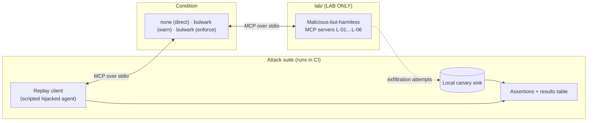
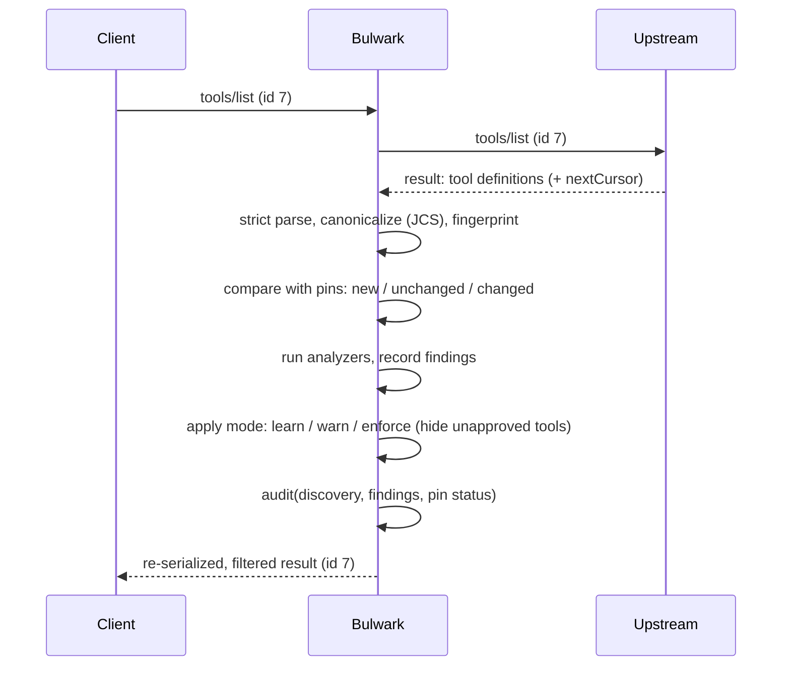
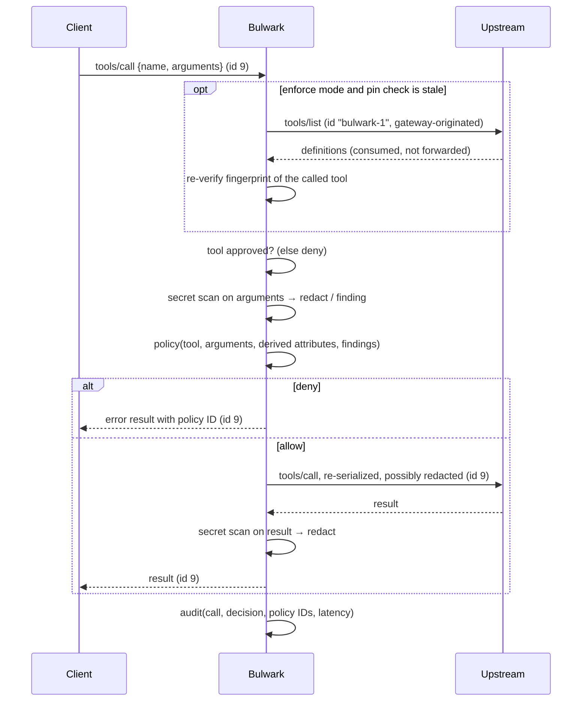
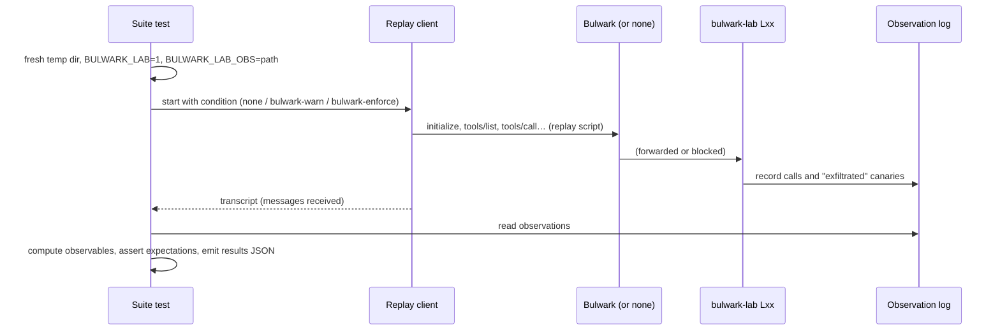
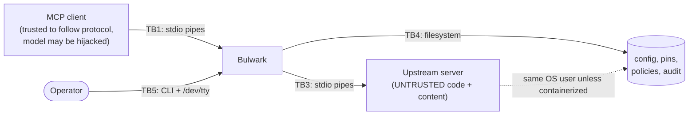

# MCP Bulwark: Design Document

## Document control
| Field | Value |
|---|---|
| Status | Draft: §1–§4 and §7 drafted (✅); §5–§6 seed notes, revised in design 03; others seeded (🌱) or not yet written (📝) |
| Version | 0.6 |
| Last updated | 2026-11-26 |
| Idea brief | [IDEA.md](IDEA.md) |
| Reviewers | Staff security engineer, SRE, ML engineer (roles) |

### Change history
| Version | Date | Summary |
|---|---|---|
| 0.1 | 2026-11-25 | Initial skeleton with seeded architecture, flows, and threat model starters |
| 0.2 | 2026-11-26 | Lab-first roadmap: attack lab and baseline benchmark moved to M1; added FR-017/FR-018; spec backlog renumbered |
| 0.3 | 2026-11-26 | Moved to standalone repository; renamed to MCP Bulwark (CLI `bulwark`); decision 1 recorded as ADR-0001 |
| 0.4 | 2026-11-26 | (Superseded before merge) Evaluation-first draft with live-model benchmark |
| 0.5 | 2026-11-26 | Gateway with deterministic attack suite (ADR-0002, amends ADR-0001). Drafted §1–§3; renumbered FR/NFR; stdio-only v0.1; $0 and no-manual-testing constraints; updated §10, §12, §14, §15 |
| 0.6 | 2026-11-26 | Design 02: §4 architecture (v0.1 stdio, attack suite components, verify-before-call), §7 threat model (STRIDE, mitigations mapping, accepted risks); ADR-0003 Go, ADR-0004 OPA; MCP baseline 2026-07-28; FR-028…032, NFR-013…015; file-based sink |

> **How to use this document:** follow [docs/WORKFLOW.md](docs/WORKFLOW.md) Stage 1. Each section lists **Questions to resolve**. Work through them with Claude one section at a time, replace the seeded material with agreed content, and log decisions in §14.

---

## 1. Context and scope ✅ (drafted v0.5, in review)

### 1.1 Background
The **Model Context Protocol (MCP)** is a JSON-RPC 2.0 protocol. Through it, an **MCP client** (inside an agent host such as an IDE, desktop assistant, or custom agent) discovers and invokes **tools**, **resources**, and **prompts** exposed by **MCP servers**. Servers run locally over **stdio** (as a subprocess) or remotely over **Streamable HTTP**. Everything a server says about its tools reaches the model's context, which makes the client–server boundary a security boundary that is rarely enforced.

MCP Bulwark is an **MCP-aware intermediary**. It acts as a server to the client and as a client to the upstream server, so it can inspect and control every message. It ships with an **attack suite** that proves each protection ([ADR-0002](docs/adr/0002-gateway-with-attack-suite.md)):



**Why no AI model is needed:** Bulwark never relies on the model behaving well. It controls what reaches the model (tool definitions, results) and which calls get through. A scripted client that sends exactly what a hijacked agent would send tests those controls deterministically. How often real models get hijacked is covered by published research (for example MCPTox), which the docs cite.

### 1.2 Scope

| Area | In scope for v0.1 | Deferred |
|---|---|---|
| Transport | stdio | Streamable HTTP (v0.2) |
| Servers per gateway | One upstream server per gateway process | Multi-server aggregation with namespacing (v0.2) |
| MCP features enforced | `tools/list`, `tools/call`, `notifications/tools/list_changed` | Resources and prompts: pinning and audit only (v0.2) |
| Server-initiated requests (sampling, elicitation, roots) | **Passed through and audited, not enforced** | Policy enforcement (v0.2+) |
| Testing | Deterministic replay scenarios + detection corpora, all in CI | Optional "bring your own model" live mode (later) |
| Session-level defenses | Per-call policy only | Taint tracking (v0.2) |

### 1.3 Target protocol revision
v0.1 targets MCP specification revision **2026-07-28**, the latest at the time of drafting, supported by the official Go SDK v1.7.0 (ADR-0003). If client and server negotiate a different `protocolVersion`, the gateway forwards the negotiation unchanged and records the version in the audit log. Over stdio, framing is newline-delimited JSON-RPC, and messages must not contain embedded newlines. `VERIFY:` 2026-07-28 changes that affect stdio (version-selection request, logging deprecation) when writing spec 003.

### 1.4 Glossary
| Term | Definition |
|---|---|
| Tool definition | The `name`, `title`, `description`, `inputSchema`, `outputSchema`, and `annotations` of a tool, as returned by `tools/list` |
| Fingerprint | SHA-256 over the canonicalized (RFC 8785 JCS) tool definition |
| Pinning | Recording an approved fingerprint and alerting on or blocking any difference |
| Rug pull | A tool definition that changes after approval |
| Tool poisoning | Instructions aimed at the model hidden in tool metadata |
| Tool shadowing | A tool whose description manipulates how the agent uses *another* tool |
| Scenario | A lab server plus a replay script and expected outcomes per condition |
| Replay client | A scripted MCP client that sends the messages a hijacked agent would send. No AI model involved |
| Condition | How the replay client reaches the lab server: `none` (direct), `bulwark-warn`, or `bulwark-enforce` |
| Canary | A fake secret planted in the lab. If it reaches the sink, data was exfiltrated |
| Sink | The **observation log**: a local file where lab servers record tool calls and "exfiltrated" canaries. No network involved (§4.2) |
| Observables | What each scenario checks: `poison_delivered` (malicious text reached the client), `forbidden_call_executed` (the upstream server ran a call it shouldn't have), `canary_exfiltrated` (a canary reached the sink) |
| Detection corpus | A set of tool definitions (poisoned or benign) used to measure analyzer detection and false-positive rates |

---

## 2. Requirements ✅ (drafted v0.5, in review)

Requirement IDs: **FR-001…FR-019 attack suite and evaluation**, **FR-020…FR-039 Gateway v0.1**, **FR-040+ later**.

### 2.1 Functional requirements

**Attack suite and evaluation**
| ID | Requirement | Priority | Source |
|---|---|---|---|
| FR-001 | The suite shall provide scenarios L-01…L-06 (§10.3) as stdio MCP servers in `lab/`. Each has a manifest declaring ID, technique, OWASP/ATLAS mapping, replay script, and expected observables per condition. | MVP | G5 |
| FR-002 | Lab servers shall use canary secrets only, record "exfiltration" only to the local observation log, and make no network connections at all. | MVP | G5 |
| FR-003 | The replay client shall execute a scenario's replay script (`initialize`, `tools/list`, `tools/call` with given arguments, waits for notifications) and record every message sent and received. | MVP | G5 |
| FR-004 | For each scenario, the suite shall assert the expected observables under each condition. At minimum, the attack must **succeed under `none`**, proving the scenario is real, and be **blocked or detected under `bulwark-enforce`**. | MVP | G5 |
| FR-005 | CI shall run the suite on every PR and publish a results table (scenario × condition) in the job summary. A failing assertion fails the build. | MVP | G5 |
| FR-006 | An analyzer corpus test shall report detection rate on poisoned tool definitions (MCPTox subset, if its license permits; `VERIFY:` license and format) and false-positive rate on benign tool definitions from real open-source MCP servers. | MVP | G2, G5 |
| FR-007 | A one-command demo (`make demo` or a container image) shall run selected scenarios with and without Bulwark and print the results table, with no setup beyond Docker or the release binary. | MVP | G6 |
| FR-032 | The `bulwark-lab` binary shall refuse to start unless `BULWARK_LAB=1` is set, and shall print a `LAB ONLY` banner to stderr on start. | MVP | G5 (T-L2) |

**Bulwark Gateway (v0.1, stdio)**
| ID | Requirement | Priority | Source |
|---|---|---|---|
| FR-020 | Gateway shall wrap one upstream stdio server command and proxy all MCP messages between client and server transparently when no policy applies. | MVP | G1 |
| FR-021 | Gateway shall fingerprint every tool definition and compare it to the pin store. New or changed tools are handled by mode: `learn` (pin automatically), `warn` (forward and alert), `enforce` (hide the tool from the client until approved). | MVP | G2 |
| FR-022 | Gateway shall run static analyzers on tool definitions and record findings with severities. At minimum: hidden Unicode, model-directed instructions, cross-tool references, and side-channel schema parameters. In `enforce` mode, tools with high-severity findings are hidden until approved. | MVP | G2 |
| FR-023 | Gateway shall evaluate a policy for every `tools/call` and enforce `allow` or `deny`. `ask` is resolved by an interactive terminal prompt when one is available; otherwise it is treated as `deny`. | MVP | G3 |
| FR-024 | Policies shall be able to constrain arguments: path prefixes, URL/domain allowlists, and regex patterns. | MVP | G3 |
| FR-025 | Gateway shall detect secrets in tool arguments and results (pattern and entropy based) and redact them according to configuration. | MVP | G3 |
| FR-026 | Gateway shall write an audit record for every decision, chained with SHA-256 hashes so that any modification or deletion is detectable. | MVP | G4 |
| FR-027 | The CLI shall support: `wrap`, `tools list/diff/approve/reject`, `policy test`, and `audit verify/tail`. | MVP | G1–G4 |
| FR-028 | Gateway shall parse every message strictly: reject duplicate object keys, invalid UTF-8, and messages over the size or depth limits. It shall forward the **re-serialized form it inspected**, never the original bytes. | MVP | G2 (T-01) |
| FR-029 | Every CLI output that includes untrusted text (tool definitions, diffs, prompts, audit fields) shall neutralize control characters, ANSI escapes, and bidi controls. | MVP | G2 (T-11) |
| FR-030 | In `enforce` mode, before forwarding a `tools/call`, Gateway shall confirm the called tool's current definition matches its approved pin, re-fetching `tools/list` itself when the last check is older than `pin_recheck_interval` (default: every call). | MVP | G2 (T-06, rug pull) |
| FR-031 | Gateway shall track request IDs per direction, use a reserved ID namespace for its own requests (never forwarded), and drop and audit responses that match no outstanding request. | MVP | G2 (T-04) |

**Later (v0.2+)**
| ID | Requirement | Priority |
|---|---|---|
| FR-040 | Streamable HTTP transport | Later |
| FR-041 | Multi-server aggregation with tool namespacing | Later |
| FR-042 | Session taint tracking and taint-aware policy | Later |
| FR-043 | Out-of-band human approval broker | Later |
| FR-044 | Prompt-injection classifier tier (CPU-only, runs in CI) | Later |
| FR-045 | OpenTelemetry and OCSF audit export | Later |
| FR-046 | Optional live-model mode: run scenarios with a real agent against a user-supplied OpenAI-compatible endpoint | Later |

### 2.2 Non-functional requirements
| ID | Category | Requirement | Measure |
|---|---|---|---|
| NFR-001 | Cost | Development, CI, and demo use no paid service | Dependency and workflow review |
| NFR-002 | Automation | All verification runs in GitHub Actions. No requirement needs a manual or local test step by the maintainer. | Every NFR and FR maps to a CI job (§10) |
| NFR-003 | Lab safety | The suite passes in a container with all networking disabled except loopback. Any other connection attempt fails the run. | CI job |
| NFR-004 | Performance | Gateway adds p95 < 5 ms per message (no ML, no human approval) | Benchmark test in CI |
| NFR-005 | Reliability | Gateway fails closed by default if policy evaluation errors | Fault-injection test |
| NFR-006 | Integrity | `audit verify` detects any modified, inserted, or deleted audit record | Tamper tests |
| NFR-007 | Privacy | No data leaves the host: no telemetry, no external calls by the gateway | Network test in CI |
| NFR-008 | Determinism | Suite results are identical across reruns (no flaky tests) | Each CI run executes the suite twice and compares results |
| NFR-009 | CI time | The full CI pipeline finishes in ≤ 10 minutes | CI timing |
| NFR-010 | Portability | Linux and macOS supported; Windows best-effort | CI matrix |
| NFR-011 | Usability | A reviewer goes from clone (or release download) to demo output in ≤ 10 minutes | Documented quickstart, scripted in CI |
| NFR-012 | Supply chain | Releases are built in CI with an SBOM and signatures (Sigstore) | Release workflow |
| NFR-013 | Resource limits | Configurable maximum message size (default 4 MiB), JSON nesting depth (default 64), outstanding requests, and notification rate. Exceeding a limit produces an error and an audit record, not a crash | Fuzz and limit tests in CI |
| NFR-014 | Attack surface | v0.1 Gateway opens no network listeners and makes no network connections | Network-disabled CI run + code review checklist |
| NFR-015 | Dependency hygiene | Dependencies pinned (`go.sum`); `govulncheck` and dependency review run in CI; no known-vulnerable dependency at release | CI job |

### 2.3 Constraints and assumptions
| ID | Type | Statement |
|---|---|---|
| C-1 | Constraint | $0 budget (NFR-001). No paid APIs, hosted services, or paid GitHub features. |
| C-2 | Constraint | Maintainer time is 1–2 hours/week. Claude designs, builds, and tests; the maintainer reviews PRs (≤ 30 minutes each). |
| C-3 | Constraint | No manual testing or local model runs (NFR-002). |
| C-4 | Constraint | The repo is private until the v0.1 launch. GitHub Actions minutes for private repos on the Free plan are limited (`VERIFY:` current allowance; 2,000 minutes/month at time of drafting). At ≤ 10 minutes per run (NFR-009) this allows about 200 runs per month. |
| A-1 | Assumption | Protocol-level replay is a faithful test of Bulwark's controls, because Bulwark acts only on protocol messages. It does **not** show how often a model would follow the malicious instructions. The docs cite published research for that (R3 in IDEA.md). |
| A-2 | Assumption | The official Go MCP SDK (stable since v1.0.0; v1.7.0 supports revision 2026-07-28) is sufficient for the lab servers and replay client. The gateway parses JSON-RPC itself (ADR-0003). |

---

## 3. Users and use cases ✅ (drafted v0.5, in review)

### 3.1 Personas
See [IDEA.md](IDEA.md#target-users). The primary persona for v0.1 is the **developer using agents**. The **portfolio reviewer** is a first-class persona: the README, demo, and design docs are written for a 10-minute evaluation.

### 3.2 Use cases
| ID | Actor | Trigger | Main flow | Outcome | Traces to |
|---|---|---|---|---|---|
| UC-01 | Portfolio reviewer | Opens the repo | Reads the README, runs `make demo` (or the container) | Sees each attack succeed without Bulwark and get blocked with it, in one table | FR-007, NFR-011 |
| UC-02 | Developer | Adds a third-party stdio server | Wraps it with `bulwark wrap -- <cmd>` in `learn` mode, reviews findings, switches to `enforce` | Poisoned description flagged; tool hidden until approved | FR-020…022, FR-027 |
| UC-03 | Developer | A server silently changes a tool (rug pull) | Gateway detects a fingerprint mismatch on the next `tools/list` | Tool quarantined; `bulwark tools diff` shows the change | FR-021, FR-027 |
| UC-04 | Developer | A hijacked agent tries to send data to an unapproved domain | Policy with a domain allowlist evaluates the `tools/call` | Call denied with the policy ID; audit record written | FR-023, FR-024, FR-026 |
| UC-05 | IR analyst | Investigating an agent's actions | `bulwark audit verify`, then `audit tail` filtered by session | Integrity confirmed; session reconstructed | FR-026, FR-027 |
| UC-06 | Contributor | Wants to add an attack | Proposes a scenario through the issue template; implements it under `lab/` with a manifest | CI runs it on every PR from then on | FR-001…005 |

### 3.3 Hero demos (README and launch write-up)
1. **UC-01 "Attacks vs. Bulwark"**: one table and a terminal recording of six attacks, each succeeding directly and blocked through Bulwark.
2. **UC-03 "Rug pull caught"**: a tool changes after approval, is quarantined, and the diff is shown.

---

## 4. Architecture ✅ (drafted v0.6, in review)

v0.1 architecture: one Bulwark process per wrapped stdio server, written in Go ([ADR-0003](docs/adr/0003-implementation-language.md)), with policies in OPA/Rego ([ADR-0004](docs/adr/0004-policy-engine.md)). It opens **no network listeners** and makes **no network connections** (NFR-014).

### 4.1 System context


The MCP client launches `bulwark wrap -- <server command>` instead of the server. Bulwark starts the real server as a child process and sits on both pipes. To the client it is a server, and to the server it is a client.

### 4.2 Components

**Gateway (`bulwark`)**
| Package | Responsibility | Key requirements |
|---|---|---|
| `cmd/bulwark` | CLI entry point: `wrap`, `tools`, `policy`, `audit` | FR-027 |
| `internal/jsonrpc` | Strict framing and parsing of newline-delimited JSON-RPC: size limits, duplicate-key rejection, UTF-8 validation, canonical re-serialization | FR-028, NFR-013 |
| `internal/proxy` | Owns both pipes and the child process lifecycle. Tracks request IDs per direction, routes messages through the pipeline, issues gateway-originated requests in a reserved ID space | FR-020, FR-030, FR-031 |
| `internal/pipeline` | Ordered interceptors keyed by (direction, method). Each returns *forward*, *modify*, or *block with error* | FR-020…025 |
| `internal/registry` | JCS canonicalization, fingerprints, pin store (JSON file), `learn`/`warn`/`enforce` modes, diffs | FR-021, FR-030 |
| `internal/analyzers` | Analyzer interface, text normalization helpers, the first four analyzers | FR-022 |
| `internal/policy` | Embedded OPA: decision-input builder (including derived attributes such as cleaned paths and URL hosts), prepared queries, decision combining | FR-023, FR-024, NFR-005 |
| `internal/redact` | Secret detectors (patterns + entropy) for arguments and results | FR-025 |
| `internal/audit` | Hash-chained JSONL writer, `verify`, `tail` | FR-026, NFR-006 |
| `internal/config` | YAML configuration with JSON Schema validation | — |
| `internal/termsafe` | Neutralizes untrusted text (control characters, ANSI escapes, bidi controls) before printing it to a terminal | FR-029 |

**Attack suite (`lab/`)**
| Package | Responsibility | Key requirements |
|---|---|---|
| `lab/cmd/bulwark-lab` | One binary containing lab servers L-01…L-06 (built on the official Go SDK). Refuses to start unless `BULWARK_LAB=1`; prints a `LAB ONLY` banner to stderr | FR-001, FR-002, FR-032 |
| `lab/scenarios/*.yaml` | Scenario manifests: technique, mappings, replay script, expected observables per condition | FR-001, FR-004 |
| `lab/replay` | Replay client: an MCP client (Go SDK) that executes a replay script and records the transcript | FR-003 |
| `lab/suite` | Go tests: for each scenario × condition, start the stack, replay, read the observation log, assert | FR-004, NFR-008 |
| `tools/ci-summary` | Renders suite results (JSON) as a Markdown table for the GitHub Actions job summary and the README | FR-005 |

**Sink design:** lab servers never use the network. Their "exfiltration" tools append to an **observation log** file given by `BULWARK_LAB_OBS`, which the suite reads to compute observables. This is safer than a loopback listener and lets the suite run with networking fully disabled (NFR-003).

### 4.3 Repository layout (v0.1)
```
cmd/bulwark/            CLI
internal/               gateway packages (§4.2)
lab/                    LAB ONLY: attack servers, scenarios, replay client, suite
  cmd/bulwark-lab/
  scenarios/
  replay/
  suite/
testdata/corpora/       detection corpora (MCPTox subset, benign definitions)
policies/examples/      example Rego policies + their tests
tools/ci-summary/
docs/                   ADRs, workflow, write-ups
.github/workflows/      CI: test, suite, lint, vuln scan, release
```

### 4.4 Key flows

**Tool discovery (`tools/list`)**

Paginated results (`nextCursor`) are handled page by page. `notifications/tools/list_changed` from upstream is forwarded to the client and invalidates the gateway's cached view, so the next `tools/list` is re-checked.

**Tool invocation (`tools/call`)**

**Verify before call (FR-030):** in `enforce` mode, the gateway re-checks the called tool's definition with its own `tools/list` when the last check is older than `pin_recheck_interval` (default: before every call). This catches a rug pull even when the server sends no `list_changed` notification and the client never re-lists. The cost is one extra local round trip per call. It can be relaxed in configuration.

**Attack suite run (CI)**


**Decided in this draft** (§14.1): one process per server (no aggregation in v0.1), file-based sink, verify-before-call by default. **Deferred to design 03:** whether a deny is returned as a JSON-RPC error or as a tool result with `isError: true`.

## 5. Detailed design 📝 (seed notes; revised in design 03)

> Seed notes below predate design 02. Where they conflict with §4 (for example multi-server aggregation or session taint in v0.1), §4 wins.

### 5.1 Tool registry and pinning
- Canonicalization: RFC 8785 JCS over `{server_id, name, title, description, inputSchema, outputSchema, annotations}`. Decide whether `annotations` count toward the fingerprint (recommendation: yes; any change is security-relevant).
- Pin store records: `server_id, tool_name, fingerprint, definition_snapshot, approved_by (role), approved_at, findings_at_approval`.
- Diffs are shown as a unified text diff of descriptions plus a structural JSON diff of schemas.
- `notifications/tools/list_changed` triggers re-discovery and re-evaluation of pins.
- **Server identity:** how is "the same server" established across runs? For stdio, a command + args + package version/hash. For HTTP, URL + TLS identity. `VERIFY:` whether the current MCP spec offers server identity metadata.

### 5.2 Static analyzers (definition inspection)
| Analyzer | Detects | Notes |
|---|---|---|
| `unicode.hidden` | Zero-width characters, bidi controls, Unicode Tags block (U+E0000–U+E007F), homoglyphs in names | High precision |
| `text.imperative` | Instructions aimed at the model ("ignore previous", "do not tell the user", `<IMPORTANT>` blocks) | Heuristic; tune against a benign corpus |
| `text.cross_reference` | Mentions of other tools or servers (shadowing) | Compare against the registry |
| `text.sensitive_ref` | References to `~/.ssh`, `.env`, credentials, tokens | |
| `schema.side_channel` | Free-text params that solicit context (`notes`, `context`, `metadata`) unrelated to the stated purpose | Exfiltration through arguments |
| `annotation.mismatch` | `readOnlyHint: true` on a tool whose name or description implies writes or egress | Annotations are **untrusted hints** per the MCP spec |
| `size.anomaly` | Unusually long descriptions | |

### 5.3 Policy engine
OPA/Rego, embedded ([ADR-0004](docs/adr/0004-policy-engine.md)). Decision input (v0.1 draft):

```json
{
  "tool": {"name": "http_post", "pin_status": "approved", "annotations": {"readOnlyHint": false}},
  "arguments": {"url": "https://api.example.com/v1/upload", "body": "…"},
  "derived": {"url_scheme": "https", "url_host": "api.example.com", "path_clean": null, "args_bytes": 812},
  "findings": [{"analyzer": "secrets", "severity": "high", "location": "arguments.body"}],
  "mode": "enforce",
  "server": {"command_digest": "sha256:…"}
}
```

Example policy. The gateway combines the sets: any `deny` → deny; else any `ask` → ask; else any `allow` → allow; else deny.

```rego
package bulwark.authz

import rego.v1

# Reads only inside the workspace (path_clean is computed by the gateway).
allow contains "fs-read-workspace" if {
	input.tool.name == "read_file"
	startswith(input.derived.path_clean, "/workspace/")
}

# Outbound HTTP only to approved hosts.
allow contains "http-allowlist" if {
	input.tool.name == "http_post"
	input.derived.url_host in {"api.example.com"}
}

# Never send anything that looks like a secret.
deny contains "no-secrets-out" if {
	some f in input.findings
	f.analyzer == "secrets"
	startswith(f.location, "arguments")
}
```

### 5.4 Taint tracker (v0.2)
- Labels are **session-level and only ever added** (they are never removed within a session). This is coarse but sound and easy to reason about.
- Sources of labels: tool classification in config (for example `email.read` → `sensitive_data`, `web.fetch` → `untrusted_content`), server trust level, and analyzer findings on results.
- Capability tags on tools: `read`, `write`, `exec`, `egress`, `read_external`.
- Inspired by information-flow defenses such as CaMeL (Google DeepMind, 2025). Clearly document what this simplified model does *not* catch, such as egress through a write tool that syncs to the cloud.

### 5.5 Inspection of results
Secret detection (regex + entropy, using rule sets similar in spirit to gitleaks) and the injection classifier score (§8). Possible actions: annotate, redact, block, or add a taint label.

### 5.6 Approval broker (v0.2)
Channels: interactive CLI, webhook (Slack/Teams), and possibly MCP elicitation back to the client. `VERIFY:` whether elicitation is suitable, since it shows the request through the very client that might be compromised. Timeout leads to the policy-defined default (deny).

### 5.7 Audit logger
See §6.3 for the record schema. Hash chain: `hash = SHA-256(prev_hash || canonical(record))`. Periodic checkpoints can be signed or anchored externally (v0.2).

**Questions to resolve**
1. Do annotations count toward fingerprints?
2. How is server identity defined for stdio and HTTP?
3. Tag tools with capabilities manually, by heuristics, or both (heuristics suggest, humans confirm)?
4. Should argument redaction ever be silent, or should the agent always be told that redaction happened?

---

## 6. Interfaces and data model 🌱 (revised in design 03)

> The configuration example below predates design 02. v0.1 configures **one upstream per `bulwark wrap` invocation**; the multi-server form is for v0.2.

### 6.1 CLI (draft)
```
bulwark run --config gateway.yaml           # start the gateway
bulwark wrap -- npx -y <server-package>    # quick local stdio wrapper
bulwark tools list|diff|approve|reject
bulwark policy test --input call.json      # dry-run a decision
bulwark audit verify|tail|export --format ocsf
bulwark lab run <scenario>                 # run attack lab scenarios
```

### 6.2 Configuration schema (draft)
```yaml
servers:
  filesystem:
    transport: stdio
    command: ["npx", "-y", "@modelcontextprotocol/server-filesystem", "/workspace"]
    trust: internal
    tools:
      read_file:  { capabilities: [read],  labels_on_result: [sensitive_data] }
      write_file: { capabilities: [write] }
  web:
    transport: http
    url: https://mcp.example.com/mcp
    trust: external
    auth: { type: oauth2, client_id_env: WEB_MCP_CLIENT_ID }
    default_labels_on_result: [untrusted_content]
pinning:
  mode: enforce            # learn | warn | enforce
  store: ./state/pins.db
policy:
  engine: opa              # ADR-0004
  path: ./policies/
  on_engine_error: deny    # fail-closed
inspection:
  secrets: { enabled: true, action: redact }
  injection_classifier: { enabled: false }
audit:
  sink: file
  path: ./logs/audit.jsonl
  hash_chain: true
```

### 6.3 Audit record (draft)
```json
{
  "ts": "2026-11-25T14:03:22.118Z",
  "seq": 1042,
  "session_id": "s_7f3a",
  "principal": "agent:code-assistant",
  "event": "tool_call",
  "server": "web",
  "tool": "fetch",
  "args_digest": "sha256:…",
  "args_redacted": {"url": "https://example.com/page"},
  "decision": "deny",
  "policy_ids": ["trifecta-egress"],
  "findings": [],
  "taint_before": ["sensitive_data", "untrusted_content"],
  "taint_after":  ["sensitive_data", "untrusted_content"],
  "latency_ms": {"gateway": 1.8, "upstream": null},
  "prev_hash": "sha256:…",
  "hash": "sha256:…"
}
```
`VERIFY:` mapping to OCSF. API Activity (class 6003) is the likely fit; confirm the class and required fields against the current OCSF schema.

**Questions to resolve**
1. Should the config format be YAML with a JSON Schema for validation? (Recommended.)
2. Which arguments are logged in full, digested, or redacted by default?

---

## 7. Security and threat model ✅ (drafted v0.6, in review)

Scope: v0.1 (stdio, one upstream per process, no network). Method: data-flow diagram + STRIDE per trust boundary, plus attacker-driven abuse cases. Threats Bulwark **mitigates** (§7.3), threats **to** Bulwark (§7.4–7.5), and **accepted risks** (§7.6) are kept separate.

### 7.1 Assets
| ID | Asset | Why it matters |
|---|---|---|
| A-1 | Data reachable through tools (files, mail, tokens) | The thing attackers want to exfiltrate |
| A-2 | Integrity of what reaches the model (tool definitions, results) | Poisoned context hijacks the agent |
| A-3 | Policy, pin store, and configuration | Tampering silently disables protection |
| A-4 | Audit log | Evidence for investigation; must be trustworthy |
| A-5 | Operator's attention and terminal | Misleading prompts and diffs trick approvals |
| A-6 | Availability of the agent's tools | A gateway that breaks work gets removed |

### 7.2 Trust boundaries


| Boundary | Between | Trust assumption |
|---|---|---|
| TB1 | Client ↔ Bulwark | Client process is trusted. **The model driving it may be hijacked**, so its requests are untrusted. |
| TB2 | Inside Bulwark | Trusted code; our own attack surface (parser, pipeline) |
| TB3 | Bulwark ↔ upstream | **Untrusted**: definitions, results, notifications, and server-initiated requests may all be malicious |
| TB4 | Bulwark ↔ local state | Trusted only if the upstream can't write to it (see AR-2) |
| TB5 | Operator ↔ Bulwark | Operator is trusted. Text shown to them comes from untrusted sources |

### 7.3 Threats Bulwark mitigates
| ID | Threat | OWASP Agentic Top 10 (Dec 2025) | OWASP LLM Top 10 (2026) | MITRE ATLAS | v0.1 control | Scenario |
|---|---|---|---|---|---|---|
| M-1 | Tool poisoning in definitions | ASI01 Agent Goal Hijack; ASI04 Agentic Supply Chain Vulnerabilities | LLM01 Prompt Injection | AML.T0051 LLM Prompt Injection | Analyzers + hide in `enforce` (FR-022) | L-01, L-06 |
| M-2 | Rug pull (definition changes after approval) | ASI04 Agentic Supply Chain Vulnerabilities | LLM01 | `VERIFY:` supply-chain technique ID | Pinning + verify-before-call (FR-021, FR-030) | L-02 |
| M-3 | Tool shadowing (one tool's text steers another's use) | ASI02 Tool Misuse and Exploitation | LLM01 | AML.T0051 | Cross-reference analyzer + argument policy (FR-022, FR-024) | L-03 |
| M-4 | Indirect injection through tool results, leading to exfiltration | ASI01 Agent Goal Hijack | LLM01; LLM02 Sensitive Information Disclosure | AML.T0051 (indirect) | Egress allowlist + secret redaction (FR-024, FR-025) | L-04 |
| M-5 | Data exfiltration through tool arguments | ASI02 Tool Misuse and Exploitation | LLM02 | `VERIFY:` exfiltration technique ID | Schema analyzer + argument redaction (FR-022, FR-025) | L-05 |
| M-6 | Over-privileged tool use | ASI03 Identity and Privilege Abuse | `VERIFY:` Excessive Agency ID in the 2026 list | — | Default-deny policy with argument constraints (FR-023, FR-024) | Policy tests |
| M-7 | No record of agent actions | ASI10 Rogue Agents (detection) | — | — | Hash-chained audit (FR-026) | Tamper tests |

> OWASP Agentic IDs and titles were confirmed against several sources in November 2026. `VERIFY:` the exact title of ASI06 (sources differ), and all ATLAS IDs other than AML.T0051, against atlas.mitre.org before v0.1.

### 7.4 Threats to Bulwark (STRIDE)
| ID | Boundary | STRIDE | Threat | Mitigation | Requirement | Residual |
|---|---|---|---|---|---|---|
| T-01 | TB3 | Tampering | **Parser differential:** a message with duplicate JSON keys (`"description"` twice) is read one way by Bulwark and another way by the client, so the analyzers inspect harmless text while the model sees the poison | Reject duplicate keys and invalid UTF-8; **forward the re-serialized form Bulwark inspected**, never the original bytes | FR-028 | Low |
| T-02 | TB3 | Tampering | Unicode tricks (homoglyphs, zero-width characters, Tag-block characters, bidi controls) hide instructions from pattern matching | Analyzers inspect both raw and NFKC-normalized text; `unicode.hidden` flags invisible characters | FR-022 | Medium (new encodings) |
| T-03 | TB3 | DoS | Oversized, deeply nested, or flooding messages (including notification storms) exhaust memory or CPU | Size and depth limits, bounded queues, rate limits on notifications; violations error out and are audited | NFR-013 | Low |
| T-04 | TB3 | Spoofing | **Response ID confusion:** upstream answers with the ID of another request, or replies to gateway-originated requests to confuse the client | Per-direction ID tracking; gateway-originated requests use a reserved ID namespace and are never forwarded; unmatched responses are dropped and audited | FR-031 | Low |
| T-05 | TB3 | Tampering | Server-initiated requests (sampling, elicitation) used to inject content or extract data | v0.1: passed through, **audited**, and flagged in `audit tail`; enforcement planned for v0.2 | FR-026 | Medium (accepted for v0.1) |
| T-06 | TB3 | Tampering | **Behavioral rug pull:** definition stays the same but the tool's behavior changes | Out of scope for pinning (definitions only); argument policy and result redaction limit impact | FR-024, FR-025 | Medium (AR-4) |
| T-07 | TB3 | Evasion | Payloads crafted to slip past analyzers (paraphrase, splitting across fields, base64) | Layered defense: pinning and policy don't depend on detection; adversarial corpus grows with each bypass | FR-006, FR-022 | Medium (AR-5) |
| T-08 | TB4 | Tampering | Pins, policies, or config modified to approve a malicious tool | File permission checks at startup (warn if group- or world-writable); every pin change is audited; container wrapping keeps the upstream away from the files | FR-026 | **High without container** (AR-2) |
| T-09 | TB4 | Repudiation | Audit records edited or deleted | SHA-256 hash chain; `audit verify`. Full chain rewrite or tail truncation is detectable only with an external anchor (v0.2 signed checkpoints) | FR-026, NFR-006 | Medium (AR-6) |
| T-10 | TB4 | Info disclosure | Secrets written into the audit log | Redact before logging; store argument digests rather than raw values by default | FR-025, FR-026 | Low |
| T-11 | TB5 | Spoofing | **Terminal escape injection:** tool text containing ANSI escapes or bidi controls makes a diff or approval prompt show something other than the truth | All untrusted text printed by the CLI goes through `termsafe` (escapes rendered visibly) | FR-029 | Low |
| T-12 | TB5 | Spoofing | Approval prompt hijack: prompts read from stdin, which carries MCP traffic | Interactive prompts use `/dev/tty` only; with no TTY, `ask` = deny | FR-023 | Low |
| T-13 | TB1 | Elevation | **Bypass:** the agent is configured to launch the server directly, not through Bulwark | Documented; `bulwark doctor` (later) checks known client configs | — | Medium (AR-3) |
| T-14 | TB2 | Tampering | Supply-chain compromise of Bulwark or its dependencies | Pinned `go.sum`, `govulncheck` and dependency review in CI, SBOM, signed releases | NFR-012, NFR-015 | Low |
| T-15 | TB2 | DoS | Policy engine error or panic leaves calls unchecked | Fail closed (NFR-005); panics in interceptors are recovered and become denials | NFR-005 | Low |

### 7.5 Attack suite threats
| ID | Threat | Mitigation | Requirement |
|---|---|---|---|
| T-L1 | Lab server touches the network or real files | No network code in lab servers; suite runs in a network-disabled job; all writes confined to a temp directory | FR-002, NFR-003 |
| T-L2 | Someone configures a lab server in a real agent by mistake | `bulwark-lab` refuses to start without `BULWARK_LAB=1`; `LAB ONLY` banner on stderr; tool descriptions carry a visible lab marker outside the attack payload | FR-032 |
| T-L3 | Lab code is reused as an attack toolkit | Only publicly documented techniques; canaries only; no evasion tuning against real products | Hard rule 4 |

### 7.6 Accepted risks (stated in the README's "Limitations" section)
| ID | Risk | Why accepted | Guidance |
|---|---|---|---|
| AR-1 | A malicious stdio server is local code running as the user. It can read files or use the network **directly**, without going through MCP | Bulwark controls the agent-mediated channel; it isn't a sandbox | Run untrusted servers in a container: `bulwark wrap -- docker run -i --rm --network none <image>` |
| AR-2 | The same server can modify Bulwark's state files (T-08) | Same as AR-1 | Container wrapping; store state outside any directory mounted into the container |
| AR-3 | Bypass through misconfiguration (T-13) | Local tool; can't control the client | Documentation; `doctor` check later |
| AR-4 | Tool behavior isn't pinned, only definitions (T-06) | Behavior can't be fingerprinted from the protocol | Argument policy, redaction; taint tracking in v0.2 |
| AR-5 | Analyzers can be evaded (T-07) | Detection is never complete | Pinning and policy work regardless of detection |
| AR-6 | The audit chain can be rewritten wholesale by someone with write access (T-09) | Needs an external anchor | Signed checkpoints in v0.2 |
| AR-7 | Prompt injection itself isn't prevented | NG1: Bulwark limits damage | — |

### 7.7 Security requirements derived from this model
These were added to §2 in v0.6: **FR-028** (strict parsing, forward what was inspected), **FR-029** (terminal-safe output), **FR-030** (verify before call), **FR-031** (request ID isolation), **FR-032** (lab binary guard), **NFR-013** (resource limits), **NFR-014** (no network listeners or connections), **NFR-015** (dependency hygiene).

## 8. AI/ML design 📝 (seed notes)

- **Where AI is used:** only for *scoring* text (tool descriptions and results) for injection likelihood. All enforcement is deterministic policy, so the security boundary does not depend on a model behaving correctly.
- **Tiered inspection:** tier 0 regex/heuristics (always on, under 1 ms) → tier 1 a small local classifier (for example a fine-tuned DeBERTa-class prompt-injection model; `VERIFY:` current best open models and licenses) → tier 2 an optional LLM-as-judge for high-risk sessions (off by default, NFR-007).
- **Evaluation datasets:** the lab corpus (poisoned definitions, injected results), public prompt-injection datasets (`VERIFY:` licenses), and a benign corpus of real servers' tool definitions and typical results.
- **Metrics:** precision/recall/F1 per tier, FPR on benign traffic, latency per tier, and the attack suite (§10.3) with the classifier enabled.
- **Failure modes:** false negatives (mitigated by taint containment), false positives (mitigated by `warn` mode and policy thresholds), model drift with new attack styles (refresh the corpus each release).
- **Fallback:** if the classifier is unavailable, tier 0 plus policy continue. Behavior is set by `on_classifier_error`.

**Questions to resolve**
1. Train or fine-tune your own classifier (strong portfolio signal; ML cost) or integrate an existing one (faster)?
2. Is tier 2 (LLM-as-judge) worth including at all, given privacy and latency?

---

## 9. Observability and operations 📝
Seed: structured logs, Prometheus metrics (decisions by type, latency histograms, findings by analyzer), OTel traces spanning client request → upstream call, health endpoints, hot reload of policies.

## 10. Testing and evaluation strategy 🌱

### 10.1 Test pyramid
Unit (analyzers, canonicalization, policy adapters) · property-based and fuzz tests (JSON-RPC parser, framing) · integration (real reference MCP servers) · end-to-end (real MCP clients with scripted agents).

### 10.2 NFR verification
Every NFR is checked by a CI job (NFR-002): load/latency test (NFR-004), fault injection (NFR-005), audit tamper tests (NFR-006), network-isolated suite run (NFR-003, NFR-007), double-run determinism check (NFR-008), pipeline timing (NFR-009), OS matrix (NFR-010), scripted quickstart (NFR-011), and release signing (NFR-012).

### 10.3 Attack suite
The attack scenarios are built **first** (M1, see §12). Each one starts as a test that the attack succeeds, and each Gateway feature is finished when its scenario is blocked or detected under `enforce`.

`lab/` contains deliberately malicious, **harmless** MCP servers. "Exfiltration" goes to a loopback sink and "secrets" are fake canaries. Every scenario works with a single upstream server, matching v0.1 scope.

| Scenario | Attack (replayed) | Observables under `none` | Blocked or detected in v0.1 by | Later control |
|---|---|---|---|---|
| L-01 Poisoned description | Hidden `<IMPORTANT>` instruction to read a canary file and pass it to another tool | `poison_delivered`, `canary_exfiltrated` | Analyzer finding → tool hidden (FR-022); path policy (FR-024) | Classifier (v0.3) |
| L-02 Rug pull | Tool definition changes after the N-th call | `poison_delivered` after change | Pin mismatch → quarantine (FR-021) | — |
| L-03 Shadowing | One tool's description tells the agent to BCC an attacker address whenever it uses the server's `send_email` tool | `poison_delivered`, `forbidden_call_executed` | Cross-reference analyzer (FR-022); recipient-domain policy (FR-024) | Cross-server shadowing with aggregation (v0.2) |
| L-04 Indirect injection | A tool result contains instructions to send a canary to an external URL | `canary_exfiltrated` | Egress domain allowlist (FR-024); secret redaction in arguments (FR-025) | Taint tracking (v0.2) |
| L-05 Argument side channel | Schema adds a free-text `context` parameter that solicits secrets | `canary_exfiltrated` | Side-channel schema analyzer (FR-022); argument redaction (FR-025) | — |
| L-06 Unicode smuggling | Unicode Tag-block characters encode hidden instructions | `poison_delivered` | `unicode.hidden` analyzer (FR-022) | — |

**Replay, not live agents:** each scenario runs with the replay client under `none`, `bulwark-warn`, and `bulwark-enforce`, and asserts the expected observables (FR-004). The suite runs on every PR (FR-005). Optional live-model runs are a later feature (FR-046). Existing public resources (`VERIFY:` "Damn Vulnerable MCP Server", MCPTox, MCP-SafetyBench) are reused where licenses allow, mainly as sources of attack patterns and detection corpora.

---

## 11. Deployment and packaging 📝
Seed: local mode (single binary wrapping stdio servers, configured in the agent's MCP config), central mode (container behind TLS, Postgres state, OIDC for admin), Helm chart later. Release signing with Sigstore/cosign, SBOM per release, SLSA provenance via GitHub Actions.

## 12. Milestones and roadmap 🌱
| Milestone | Scope | Exit criteria |
|---|---|---|
| M0 | Design approved | Design review checklist passed |
| M1 | **Attack suite + transparent stdio proxy + audit log** | L-01…L-06 run in CI under all conditions; attacks succeed under `none` and (as expected at this stage) also through the passthrough proxy; network-isolation test passes; audit chain verifies |
| M2 | Pinning + static analyzers + CLI + detection corpora | L-01, L-02, L-03, L-06 blocked or detected under `enforce`; detection rate and false-positive rate reported in CI |
| M3 | Policy engine + argument constraints + secret redaction + demo + release pipeline; **v0.1 release** | All six scenarios blocked or detected under `enforce`; NFR-004 met; signed release with SBOM; one-command demo; launch write-up drafted for the maintainer to publish |
| M4 | Streamable HTTP + multi-server aggregation + taint tracking + approval broker; **v0.2** | New scenarios for HTTP and taint pass |
| M5 | Classifier tier (CPU, in CI) + OTel/OCSF export + optional live-model mode; **v0.3** | Classifier corpus results in CI |

**Why attacks first:** every protection starts as a failing attack test and is finished when that test passes. This is test-driven development applied to security, and it means the README's claims are all backed by CI ([ADR-0001](docs/adr/0001-lab-first-roadmap.md), amended by [ADR-0002](docs/adr/0002-gateway-with-attack-suite.md)).

## 13. Alternatives considered
| Decision | Chosen | Alternatives | Where |
|---|---|---|---|
| Positioning | Gateway + deterministic attack suite | Live-model benchmark; gateway only; benchmark only | [ADR-0002](docs/adr/0002-gateway-with-attack-suite.md) |
| Language | Go | Python, TypeScript, Rust | [ADR-0003](docs/adr/0003-implementation-language.md) |
| Policy engine | OPA/Rego with a default-deny combiner | Cedar, custom YAML, Go plugins | [ADR-0004](docs/adr/0004-policy-engine.md) |
| Deployment shape (v0.1) | One process per wrapped server | Aggregating gateway (v0.2) | §4, decision 9 |
| Lab sink | Observation log file | Loopback HTTP listener (needs networking in tests) | §4.2, decision 10 |
| Rug-pull detection | Verify before call (gateway-initiated `tools/list`) | Rely on `list_changed` notifications only (misses silent changes) | §4.4, decision 11 |
| Forwarding | Re-serialize the inspected message | Forward original bytes (parser-differential risk, T-01) | §7.4, decision 12 |

## 14. Decision log and open questions

### 14.1 Decision log
| # | Decision | Rationale | ADR | Date |
|---|---|---|---|---|
| 1 | Attacks first: attack scenarios are built before the features that block them | Test-driven security; every claim backed by CI | [ADR-0001](docs/adr/0001-lab-first-roadmap.md) (amended) | 2026-11-26 |
| 2 | Gateway with a deterministic attack suite; no live-model benchmark in v0.1 | Portfolio purpose, $0 budget, and no maintainer time for experiments; evidence differentiates in a crowded field | [ADR-0002](docs/adr/0002-gateway-with-attack-suite.md) | 2026-11-26 |
| 3 | v0.1 Gateway is stdio-only with one upstream server | Cuts the MVP to a size one person can deliver; covers the local-developer use case | — | 2026-11-26 |
| 4 | $0 budget and fully automated testing: OSS dependencies, GitHub Free, all verification in CI | Maintainer constraints | — | 2026-11-26 |
| 5 | Use MCPTox poisoned tool definitions as analyzer test data (license permitting) | Deterministic detection metric comparable with published research | — | 2026-11-26 |
| 6 | Sampling/elicitation passed through and audited, not enforced, in v0.1 | Keeps the MVP small; still visible in audit logs | — | 2026-11-26 |
| 7 | Working agreement: Claude drafts with recommendations applied; maintainer reviews by PR | Maintainer has 1–2 h/week | — | 2026-11-26 |
| 8 | Go for gateway, lab, and suite; MCP baseline 2026-07-28 | Single-binary releases, native OPA, stable official SDK | [ADR-0003](docs/adr/0003-implementation-language.md) | 2026-11-26 |
| 9 | One gateway process per wrapped server in v0.1 | Simplest model; matches how MCP clients launch stdio servers | — | 2026-11-26 |
| 10 | Lab sink is an observation log file, not a network listener | Lets the suite run with networking fully disabled | — | 2026-11-26 |
| 11 | Verify-before-call in `enforce` mode, default every call | Catches silent rug pulls; costs one local round trip | — | 2026-11-26 |
| 12 | Forward re-serialized inspected messages; reject duplicate keys | Closes parser-differential bypasses (T-01) | — | 2026-11-26 |
| 13 | OPA/Rego with default-deny combiner and gateway-derived attributes | Expressive, testable, widely recognized | [ADR-0004](docs/adr/0004-policy-engine.md) | 2026-11-26 |

### 14.2 Open questions
- Q1 Deny response format: JSON-RPC error vs. tool result with `isError: true` (design 03; test with real clients)
- Q2 Pin store location and format details; server identity for stdio (design 03)
- Q3 Classifier strategy (v0.3)

## 15. Spec backlog (draft)
| Spec | Title | Traces to | Milestone |
|---|---|---|---|
| 001 | Lab scenarios L-01…L-06 + manifests + observation log | FR-001, FR-002, FR-032, NFR-003 | M1 |
| 002 | Replay client + scenario runner + CI results table | FR-003, FR-004, FR-005, NFR-008 | M1 |
| 003 | stdio proxy passthrough + strict JSON-RPC handling + request ID isolation | FR-020, FR-028, FR-031, NFR-004, NFR-013, NFR-014 | M1 |
| 004 | Hash-chained audit log + `audit verify/tail` | FR-026, NFR-006 | M1 |
| 005 | Fingerprinting + pin store + modes + verify-before-call | FR-021, FR-030 | M2 |
| 006 | Static analyzers (first 4) + detection corpora | FR-022, FR-006 | M2 |
| 007 | `tools` CLI (list/diff/approve/reject) + terminal-safe output | FR-027, FR-029 | M2 |
| 008 | Policy engine + argument constraints + `policy test` | FR-023, FR-024, NFR-005 | M3 |
| 009 | Secret detection + redaction | FR-025 | M3 |
| 010 | One-command demo + release pipeline (SBOM, signing, vuln scan) | FR-007, NFR-011, NFR-012, NFR-015 | M3 |
| 011 | Streamable HTTP + multi-server aggregation | FR-040, FR-041 | M4 |
| 012 | Taint tracker + taint-aware policy | FR-042 | M4 |
| 013 | Approval broker | FR-043 | M4 |
| 014 | Injection classifier tier | FR-044 | M5 |
| 015 | OTel + OCSF exporters | FR-045 | M5 |
| 016 | Optional live-model mode | FR-046 | M5 |

## Appendix: References
- Model Context Protocol specification, revision 2026-07-28: modelcontextprotocol.io/specification/2026-07-28
- Official MCP Go SDK: github.com/modelcontextprotocol/go-sdk (v1.7.0)
- Open Policy Agent: openpolicyagent.org
- OWASP GenAI Security Project: Top 10 for LLM Applications 2026; Top 10 for Agentic Applications (Dec 2025): genai.owasp.org
- Cloud Security Alliance, *MCP Tool Poisoning and Rug Pull Attacks* whitepaper (May 2026)
- arXiv 2603.22489: study of tool-poisoning defenses in MCP clients (2026)
- Debenedetti et al., *Defeating Prompt Injections by Design* (CaMeL), Google DeepMind, 2025 (`VERIFY:` citation)
- Simon Willison, "The lethal trifecta for AI agents" (2025)
- RFC 8785 JSON Canonicalization Scheme; JSON-RPC 2.0 specification
- MITRE ATLAS: atlas.mitre.org
